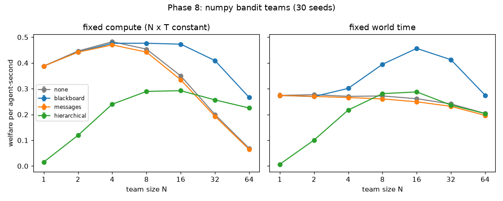
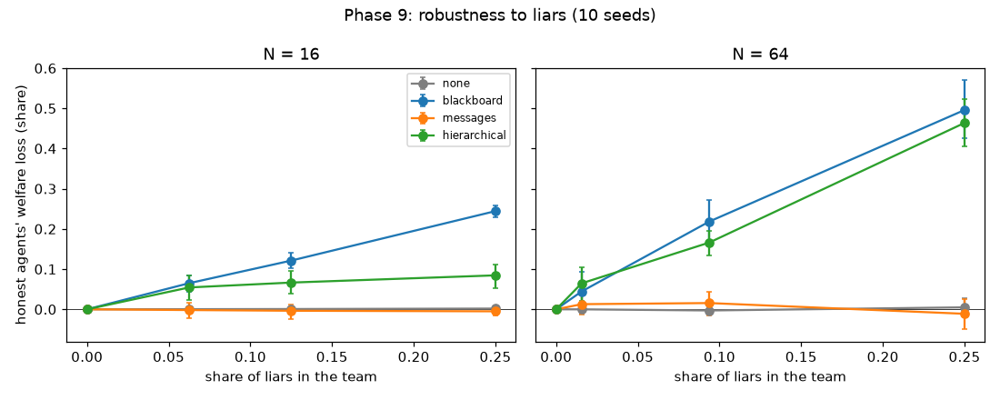
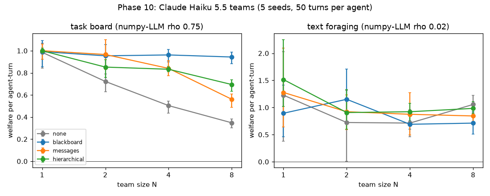
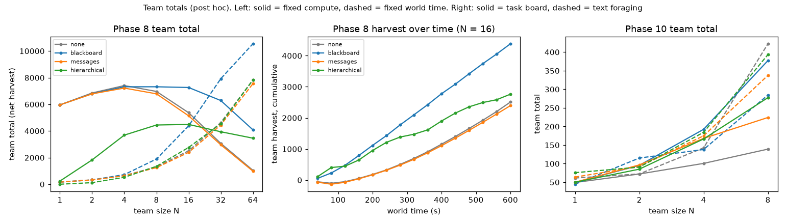
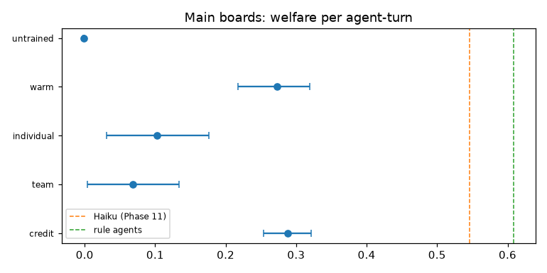
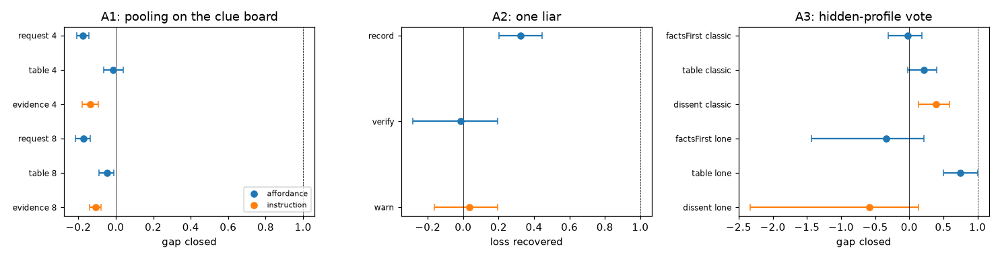

# Multi-agent harnesses: results report (Phases 5-10)

Generated by `nbs/demo_multiagent.ipynb` from the saved results (no rerun). Specs: `specs/multiagent/`.

## Question and answer

> At a fixed total compute budget, how does team performance change with team size under different communication harnesses, and how robust is each harness when one agent lies?

**Answer (numpy agents, Phases 8-9; confirmatory).** With a shared map (blackboard), output per agent holds up as the team grows at fixed compute (0.266 [0.260, 0.272] welfare per agent-second at N = 64, vs 0.068 [0.067, 0.069] without a channel); teams reach the ideal free distribution faster and agree more; and the same shared map makes them more vulnerable to a liar than peer messages are. All four pre-registered tests were supported. **With language-model agents (Phase 10; exploratory)** the picture splits by task: on a task board where the risk is duplicate work, a shared claim board keeps welfare per agent-turn flat from 1 to 8 agents while teams without one lose two-thirds of it, and the numpy model predicts the ranking of harnesses (rho 0.75); in text foraging no harness helps reliably and the numpy model does not predict the LLM teams (rho 0.02).

## 1. Pre-registered tests

| Test (blackboard minus no channel, or minus messages for H3) | Mean [95% CI] | Holm p | Verdict |
|---|---|---|---|
| P: welfare per agent-second, N 2-64, fixed compute (Phase 8) | 0.091 [0.088, 0.093] | 0.0003 | **supported** |
| H1: recovery time to the ideal free distribution, s, N 4-64 (Phase 8) | -7.545 [-8.101, -7.030] | 0.0003 | **supported** |
| H2: belief diversity, N 4-64 (Phase 8) | -0.109 [-0.111, -0.108] | 0.0003 | **supported** |
| H3: honest agents' loss from one liar, blackboard minus messages, N 8-32 (Phase 9) | 0.041 [0.033, 0.049] | 0.0001 | **supported** |

30 seeds each, run once on frozen pre-registrations (Phase 8 `PREREG` hash `8a59293847ae`, Phase 9 `PREREG_H3` hash `a44617201f88`).

## 2. Scaling per harness (Phase 8)

At fixed compute (left) every team gets the same total agent-time, so bigger teams run for less time each. Without a channel, or with messages, output per agent collapses as the team grows; the blackboard holds up; the lead starts worst and improves with size. At fixed world time (right) the blackboard gains from size up to 16 agents.

## 3. Robustness to liars (Phase 9)

Loss of honest agents' welfare as the share of liars grows. On the blackboard and with the lead, liars do real damage (a quarter of the team lying costs 50% on the blackboard at N = 64); through messages and with no channel, nothing measurable. Private trust weighting was the only defence that paid; shared reputation and sanctions cost more in monitoring than they saved.

## 4. Language-model agents (Phase 10, exploratory)

Claude Haiku 5.5 teams of 1-8, 50 turns per agent, 5 seeds; 47988 API calls, $40.60 in all (cap $150); analysis plan hash `83df7591d1de`.

- **Task board:** without a channel, welfare per agent-turn falls from 0.99 [0.84, 1.07] (alone) to 0.35 [0.30, 0.38] at N = 8 (duplicate work); the claim blackboard's benefit grows with size (+0.23, +0.46, +0.60 at N = 2, 4, 8).
- **Text foraging:** no harness helps reliably; at N = 8 the blackboard costs -0.34 [-0.48, -0.13], with less exploration and lower belief diversity: the herding side of H2.
- **Numpy predicts LLM?** Spearman rho over the 16 (harness, size) cells: board 0.75 [0.55, 0.93], foraging 0.02 [-0.47, 0.45].
- **Stronger model (Claude Sonnet 5.5, board, N 1 and 4):** harness benefit minus Haiku's: blackboard -0.03 [-0.08, 0.01], messages -0.09 [-0.17, 0.04], lead -0.12 [-0.30, 0.01]: smaller at N = 4 but unclear overall, and confounded by Sonnet's many more wrong answers at low effort.
- **Tokens as compute:** at an equal budget of 200 agent-turns, two agents did best; splitting further did not pay. Prompt-only changes (team or credit framing, persistent notes) did nothing clear; notes-only memory hurt.

## 5. Team totals (post hoc)

Per-agent welfare must fall when patches have limited capacity; the team total shows whether more agents still add food. At fixed compute the two rank teams identically (the total is per-agent welfare times a constant). At fixed world time (Phase 8) the blackboard team's total grows from 164 [159, 169] with one agent to 4383 [4337, 4428] at N = 16 and 10545 [10400, 10687] at N = 64, against 7832 [7801, 7865] without a channel at N = 64. On the Phase 10 task board each added agent still adds value with the claim board (marginal gain 46.2 per added agent from 4 to 8) but much less without one (9.6).

## 6. Follow-up runs after Phase 10 (exploratory)

- **Hard board (D1):** paused. Claude Haiku 5.5 solved 91-98% of the puzzles it opened even at difficulty 10 and 12, so no level reached the planned 30-70% band; the puzzles are to be redesigned.
- **Model size at matched effort (D2):** Sonnet's blackboard benefit minus Haiku's at N = 4: effort low -0.10 [-0.15, -0.02], effort medium -0.01 [-0.09, 0.15].
- **Rounds and soft territories, numpy (B-numpy):** at N = 8, squads that stay home earn 0.115 [0.101, 0.128] more per agent-second than the event-driven team; synchronous rounds alone cost welfare at every size, and at 32-64 agents no squad arm comes back to the event-driven level.
- **Rounds and squads, LLM (B-LLM, N = 8):** rounds minus event-driven -0.03 [-0.36, 0.37]; squads minus rounds -0.03 [-0.60, 0.48] (welfare per agent-turn).

Details: `specs/multiagent/speedup/README.md`, `results/multiagent/followup/*/report.md`.

## 7. Phase 11: the clue board (exploratory)

Each subtask's answer is fixed by two modular clues ("x mod 7 = 3") dealt to different agents, so nobody can solve it alone and sharing (which costs a turn) is load-bearing. Claude Haiku 5.5, 4 channels x N 2, 4, 8, seeds 900-904; plan frozen before the runs (`CLUE_PLAN`).

- **Sharing is load-bearing for LLM teams too:** the blackboard adds 0.39 [0.37, 0.40] welfare per agent-turn over no channel at N = 4 (blackboard 0.55, none 0.16), and keeps it to N = 8 (0.37 [0.33, 0.41]).
- **Messages decay with team size**, as for rule agents: benefit 0.40, 0.31, 0.19 at N = 2, 4, 8.
- **The coordinator fails with LLM agents** (benefit 0.10 at N = 4), although it was the best channel for rule agents at scale: it routes a clue only to agents who have that subtask open when it is shared, and Haiku ignored its suggestion in 62% of its opens, so few shared clues reached anyone (routed clues showed in 74 of 800 observations at N = 4).
- **Numpy predicts LLM** well here: Spearman rho 0.79 [0.74, 0.81] over the 12 (channel, N) cells; the coordinator cells are the main misses.
- **Liar:** one false-clue liar among 4 costs the honest agents 0.36 [0.23, 0.52] on the blackboard and 0.26 [0.21, 0.29] with messages; the blackboard-minus-messages sign agrees with H3, but its interval includes zero (3 seeds).
- **Framing** (team vs own reward wording) changed nothing clear.

Details: `specs/multiagent/phase11/README.md`, `results/multiagent/clue/full/report.md`.

## 8. Phase 12, Track A: better instructions for Claude (exploratory)

Three changes to the Phase 11 clue board for Claude Haiku 5.5, compared paired on seed with the Phase 11 runs (seeds 900-904; plan frozen before the runs, `TRACKA_PLAN`). Welfare per agent-turn, change from Phase 11:

- **Telling agents to follow the coordinator made the team worse:** -0.13 [-0.16, -0.10] at N = 4, -0.16 [-0.19, -0.13] at N = 8. Haiku then followed it almost always, but opened subtasks it knew nothing about and waited for clues the coordinator does not pass on.
- **Passing on the coordinator's collected clues helped:** 0.12 [0.07, 0.16] at N = 4, 0.07 [0.02, 0.11] at N = 8, though the coordinator still trails the blackboard.
- **Showing who works on what did little:** 0.03 [0.01, 0.05] on the blackboard at N = 4.

A coordinator helps by moving information, not by giving orders. Track B (RL training of an open model on the same board) is section 9. Details: `specs/multiagent/phase12/README.md`, `results/multiagent/coop/full/report.md`.

## 9. Phase 12, Track B: training an open model to cooperate (exploratory)

Qwen2.5-3B-Instruct on the same clue board (4 agents, blackboard, 15 boards; plan frozen before the runs, `RL_PLAN` version 2): a warm start imitating the rule agents, then 60 steps of RL on a LoRA adapter under three rewards: individual (own solves), team (the team's score) and credit (the solves that one's moves enabled). One training run per reward. Welfare per agent-turn:

- **Imitation did the teaching:** untrained -0.001, warm start 0.27 [0.22, 0.32] (Haiku minus warm start 0.24 [0.19, 0.29]).
- **RL did not beat the warm start** (change from it): credit 0.02 [-0.03, 0.06], individual -0.17 [-0.27, -0.07], team -0.20 [-0.26, -0.14].
- **Individual reward taught selfishness:** shares per held clue fell from 0.92 to 0.15, and 74% of its solves were guesses (3.8 wrong answers per solve).
- **Team reward was unstable:** with no way to tell whose move helped, training collapsed mid-run and the stopping rule halted it at step 56; the evaluated adapter is that run's last, degenerate one.
- **Credit reward kept cooperation intact:** credit minus individual 0.19 [0.09, 0.27], minus team 0.22 [0.14, 0.29]; with three trained agents and one Haiku it was the best partner (-0.16 [-0.20, -0.12] against an all-Haiku team; warm start -0.22 [-0.27, -0.16]).

Better instructions (Track A) and imitation helped; RL did not improve cooperation, and the wrong reward destroyed it. Credit assignment is what kept RL from harming the team. Details: `specs/multiagent/phase12/README.md`, `results/multiagent/rl/eval/report.md`. **Revised by section 10:** with a second training seed, RL with credit reward did beat the warm start; the one-seed null result above was seed luck.

## 10. Phase 13: from diagnosis to fixes (exploratory)

Fixes for the failures Anthropic's red team reported, each against a prompt-only control and reported as the share of a gap closed against an explicit ceiling (Claude Haiku 5.5; plan frozen before the runs, `FIX_PLAN`).

- **Communication has a price.** On the clue board, where a message costs a turn, a request board widened the pooling gap (-0.18 [-0.21, -0.14] at N = 4) and an instruction to share first lowered output too (-0.14 [-0.18, -0.09]); a fact table did nothing (-0.01 [-0.06, 0.04]).
- **Public reputation beats private verification.** A harness-computed track record of each sender recovered 0.32 [0.20, 0.44] of a liar's damage at no cost without a liar (0.006 [-0.012, 0.026]); a costly private check caught lies but recovered -0.01 [-0.28, 0.19]; a warning did nothing (0.03 [-0.16, 0.20]).
- **Aggregation, not only disclosure.** In a hidden-profile vote, a table of the posted facts closed 0.75 [0.50, 1.00] of the lone-dissenter gap without raising disclosure; enforcing facts first did nothing (-0.02 [-0.31, 0.18]); asking members to speak up closed 0.39 [0.14, 0.59] of the classic gap.
- **RL with the right incentive beats imitation, and a mechanism fix suffices.** Pooled over two training seeds, credit reward gained 0.068 [0.026, 0.112] over the warm start and credit with per-turn advantages 0.069 [0.018, 0.120]; individual reward with a training-only cost per wrong answer kept agents sharing (the loophole priced) and gained 0.053 [0.000, 0.106]. The same credit configuration gained 0.015 with one seed and 0.120 with another.

Details: `specs/multiagent/phase13/README.md`, `results/multiagent/fix/full/report.md`, `results/multiagent/rl/eval_p13/report.md`; preprint draft in `paper/`.

## Limitations

- The numpy results come from a small, abstract world; the LLM results are exploratory, with 3-5 seeds per cell and one sampled reply per request (reruns are exact only through the response cache).
- The task board turned out easy for Claude Haiku 5.5 (solve rate 0.89 at the hardest usable difficulty), so it tests coordination against duplicate work, not division of hard labour (Phase 11 makes information the bottleneck instead).
- The free-riding index does not flag free-riders as defined (Phase 9).

## Where to look

- Phase specs and results: `specs/multiagent/phase5/` to `phase12/` (each with a plain-language figure guide).
- Full per-phase reports: `results/multiagent/bench/full/report.md`, `safety/h3/report.md`, `safety/full/report.md`, `llm/full/report.md`.
