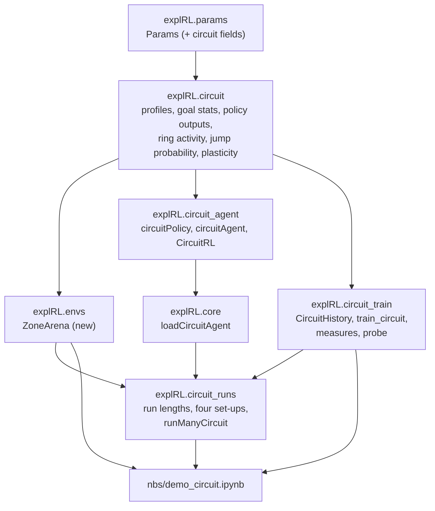

# High-level design: circuit model

## Modules



| Notebook | Exports | Contents |
|---|---|---|
| `nbs/params.ipynb` | `explRL/params.py` | 6 new fields and checks |
| `nbs/envs.ipynb` | `explRL/envs.py` | `ZoneArena` |
| `nbs/circuit.ipynb` (new) | `explRL/circuit.py` | pure functions: Eqs. 26-39 on numpy arrays |
| `nbs/circuit_agent.ipynb` (new) | `explRL/circuit_agent.py` | policy, agent, Hebbian RL class |
| `nbs/circuit_train.ipynb` (new) | `explRL/circuit_train.py` | training loop, history, measures, probes |
| `nbs/circuit_runs.ipynb` (new) | `explRL/circuit_runs.py` | run lengths and the four named set-ups (`runManyCircuit`) |
| `nbs/00_core.ipynb` | `explRL/core.py` | `loadCircuitAgent` |
| `nbs/demo_circuit.ipynb` (new) | - | demo, `#| slow` acceptance AC-8 to AC-10 |

The flexible and pre-structured modules are not touched. `ZoneArena` uses `circuit.ringActivity`, so `explRL.envs` imports from `explRL.circuit`; the agent never imports the arena (D4). The demo builds `ZoneArena` objects directly; there is no new `loadEnv` variant.

## One iteration (data flow)

```mermaid
sequenceDiagram
  participant T as train_circuit
  participant A as circuitAgent
  participant L as CircuitRL
  participant E as ZoneArena
  T->>L: chooseAction(agent)
  L->>A: sampleSaccade() (direction from dS(c), size)
  loop each grid step of the saccade
    T->>E: ringActivity(a)
    T->>L: updateCompass(agent, activity, size)  [if compass learning]
    T->>A: a += d, c -= d
  end
  T->>E: ringActivity(a)
  T->>A: maybeJump(activity)  [if jumps; pJ from wC]
  T->>E: valence(a)
  T->>A: sampleFixation() (nuF at the new c)
  T->>L: updateGoal(agent, R, ceil(fixDur / dtG))  [if goal learning]
```

## Main decisions

**D1. Grid headings.** Both headings are integers on the `N = 32` grid, as in Algorithm 3 and the Methods. Saccade sizes are drawn in degrees and turned into a whole number of steps (Q10). This keeps ring neurons, compass neurons and goal neurons on one shared index and avoids interpolation.

**D2. Pure functions first.** All equations live in `explRL.circuit` as functions of arrays (`wG`, `wC`, indices). The agent and training loop only call them. This makes Eqs. 30-39 easy to test one by one (AC-2 to AC-6), as the closed forms in the paper can be checked against the sums.

**D3. Weights live on the policy, learning lives in `CircuitRL`.** `circuitPolicy` holds `wG` and `wC`; `CircuitRL` changes them. This keeps the `Policy` / `Agent` / `RL` split used by the other two variants. One training loop with three switches (compass learning, goal learning, jumps) covers all set-ups of Figs 3-5.

**D4. The arena owns the scene.** `ZoneArena` knows the zones (reward) and the scene type (which ring neurons fire at each arena heading). The agent never reads the arena heading's zone directly; it only gets ring activity and valence through the loop, as in the paper.

**D5. Fixation after the saccade.** An iteration is saccade, jump, fixation (Algorithm 3's order), with the fixation length taken at the heading where the fixation happens (Q6). The pre-structured agent uses the order fixation, saccade; both evaluate the fixation where it happens, which is what matters.

**D6. Measures in arena coordinates through the mirror sum.** The goal heading is in compass coordinates. Plots and acceptance checks need it in arena coordinates, given by `s - thetaG`. Since the safe zones repeat every 180 degrees, the distance to the nearest safe center is the same before and after a jump, so no extra bookkeeping is needed.

**D7. Frozen probes.** As in Fig 5c, behavior at a given time is measured by copying the agent, freezing its weights, and running a separate 240 s probe with jumps on and learning off. A probe gives the PI score (Fig 5), the jump rate (compass stability, Fig 4) and a history for the readout (Fig 4d). Probes use their own seeds so they do not change the training run. In `'both'`, probes run at 0, 300, 600, 900 and 1200 s of training; in the compass set-ups, before and after training.

**D8. Four named set-ups.** `runManyCircuit` (in `explRL.circuit_runs`) knows four set-ups (`'goal'`, `'compass_asym'`, `'compass_sym'`, `'both'`), each a fixed recipe of scene, starting weights, switches and run lengths (design-low-level section 8b). The demo and the slow tests only pick a set-up and a number of flies, so the recipes live in one place. In `'both'`, the same agent continues from pre-training into training, keeping its headings and compass weights; only the scene and goal weights change. Training runs in segments between probes, and each segment continues the clock of the previous one (`train_circuit(..., t0=...)`), so the joined history has increasing times.

## Risks

| Risk | Effect | Mitigation |
|---|---|---|
| Our sign and scale choices (Q2-Q9) differ from the authors' code | Results differ in detail from the paper's figures | Acceptance checks only test qualitative shapes; every choice is recorded and testable; check the published SI if available |
| Literal Algorithm 4 order (Q6) was what the authors ran | Our behavior is "better" than theirs | The difference is one line (where `sampleFixation` reads `nuF`); the prototype result for both orders is in the README |
| Compass weights converge slowly (each saccade step changes a row by at most about 0.007) | Fig 4 needs long runs | Run lengths come from the prototype (Q12); AC-9 thresholds have margin |
| In a symmetric scene, `pJ` at opposite headings always adds up to 1, so the mean `pJ` along a map is 0.5 for any weights | A map-based stability check would always pass | Symmetric stability is judged by the probe jump rate (AC-9); `mapJumpProb` is only plotted |
| Per-step Python loops | Slow demo with many flies | Prototype runs all four set-ups for 20 flies in about 11 s (2 flies, used by normal tests: about 1 s); `nRuns` stays a parameter |
| `heldValue` time averages differ from the prototype's averages over iterations | AC-8 numbers shift | Thresholds are comparisons (smaller / larger), not exact values; the measured numbers replace the prototype's in T9 |
