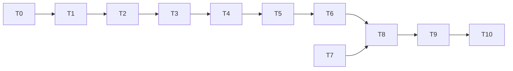

# Tasks: circuit model

Status: all tasks T0-T10 done (2026-10-10). No tuning needed in T9.

Rules for every task:

- Write code and tests in the notebook, then run `nbdev-export` and `nbdev-test --n-workers 0` (with `.venv/bin` first on `PATH`).
- A task is done only when its tests pass and all earlier tests, including both existing demos, still pass.
- Keep each exported file under about 200 lines.
- Section numbers below refer to [design-low-level.md](design-low-level.md).

## Order

T4 comes after T3 because `ZoneArena.ringActivity` calls `circuit.ringActivity`.

## T0. Confirm open decisions (done)
- **What**: get answers to Q1-Q12 in [README.md](README.md); if the published SI is available, check Eqs. 33, 34, 38-39 and Algorithms 3-4 there.
- **Done when**: answers are written into the README's table as "Decided". Done on 2026-10-10 (all as recommended; published SI not checked).

## T1. Parameters
- **Files**: `nbs/params.ipynb`.
- **What**: add `nCirc, kappaEB, alphaC, alphaG, nuMax, dtG` with the checks in section 1.
- **Tests**: defaults match Table 1 and section 1; each bad value raises `ValueError` (odd or too small `nCirc`, non-positive `kappaEB`, `nuMax`, `dtG`, negative learning rates); existing params tests still pass.

## T2. Populations, goal statistics, policy outputs
- **Files**: new `nbs/circuit.ipynb` (exports `explRL/circuit.py`).
- **What**: `grid`, `rEB`, `rFB`, `fbNorm`, `goalStats`, `sinGoal`, `outputs` (sections 2-3).
- **Tests**: `rEB` has min 0, max 1, peak at `c`; `fbNorm(32) = 12`; **AC-2**; **AC-3**; the table in section 10; `sinGoal` raises `ValueError` for `g` outside `[0, 0.5]`.

## T3. Ring activity, jump probability, plasticity
- **Files**: `nbs/circuit.ipynb`.
- **What**: `ringActivity`, `jumpProb`, `hebb`, `antiHebbGoal`, `compassStep`, `goalStep` (sections 4-5).
- **Tests**: activity patterns for both scenes (3 or 6 active neurons, values 1 and 0.5, wrapping at 0 and `N-1`); `pJ` in `[0, 1]`, 0.5 for equal net weights and for all zeros; **AC-4**; **AC-5**; weights stay in `[0, 1]` when starting from all zeros and all ones.

## T4. Zone arena
- **Files**: `nbs/envs.ipynb`.
- **What**: `ZoneArena` (section 6).
- **Tests**: 16 safe and 16 danger steps for `N = 32`; safe at 90 and 270 degrees, danger at 0 and 180; the half-open zone edges (45 degrees is safe, 135 degrees is danger); `valence` is +1 / -1; `ringActivity` matches `circuit.ringActivity` for both scenes; `safeDistance` is the same for angles 180 degrees apart; `HeadingArena` tests unchanged.

## T5. Agent and learning rule; loader
- **Files**: new `nbs/circuit_agent.ipynb` (exports `explRL/circuit_agent.py`); `nbs/00_core.ipynb`.
- **What**: `circuitPolicy`, `Saccade`, `circuitAgent`, `CircuitRL` (section 7); `loadCircuitAgent` (section 9).
- **Tests**: `TypeError` for a wrong policy type; `ValueError` for weights outside `[0, 1]` or of the wrong shape; **AC-6**; `chooseAction` returns a `Saccade` with `steps >= 1` and `size` in radians; a CW move raises `a` and lowers `c`; `maybeJump` adds `N/2`; fixation lengths positive; each switch turns its update or the jump draw off; the loader with one seed gives the same starting heading, weights and draws; `c == a` at the start.

## T6. Training loop, measures, probes, multi-fly runs
- **Files**: new `nbs/circuit_train.ipynb` (exports `explRL/circuit_train.py`) and new `nbs/circuit_runs.ipynb` (exports `explRL/circuit_runs.py`; split out to keep files under 200 lines).
- **What**: `CircuitHistory`, `concatHistory`, `endTime`, `train_circuit` (with `t0`), `goalArena`, `goalSafeDistance`, `heldValue`, `piScore`, `readout`, `mapJumpProb`, `stablestCompass`, `probe` (section 8); `LENGTHS`, `SETUPS`, `runLengths`, `goalDistanceNow`, `lastQuarterMean`, `runManyCircuit` with its four set-ups (section 8b).
- **Tests**: the last iteration starts before `Ttot` and ends at or after it; arrays the same length; times increase, and `t0` shifts them; an empty run gives an empty history; **AC-7**; `heldValue`, `piScore` and `readout` on hand-built histories (the turn bias uses the next saccade); `mapJumpProb` has length `N` and equals `jumpProb` at the paired headings; `stablestCompass` points at the stable heading for a hand-built `wC`; `probe` returns a history, PI and jump rate and leaves the original agent's weights and generator unchanged; in a symmetric scene `mapJumpProb` at `a` and `a + N/2` adds up to 1; `lastQuarterMean` on a hand-built history; `runManyCircuit` with short `lengths` returns one dict per fly with the documented keys for each set-up, and `'both'` returns 5 probe times and PI values, starts 90 degrees from safe, and has increasing times; unknown set-up or length names raise `ValueError`.

## T7. Artifact folder
- **Files**: `.gitignore`.
- **What**: ignore `results/demo_circuit/` (the artifact helpers already take `demo_name`).
- **Tests**: none beyond the demo writing there.

## T8. Demo notebook
- **Files**: new `nbs/demo_circuit.ipynb`; `nbs/sidebar.yml` (lists `circuit`, `circuit_agent`, `circuit_train`, `circuit_runs` and `demo_circuit`).
- **What**: the sections and files in section 11, with `demo_name='demo_circuit'`: quick cells (2 flies) in normal tests, full cells (20 flies) marked `#| slow`; regenerate the sidebar so it lists the new notebooks.
- **Done when**: `nbdev-test` runs the quick version in a few seconds, every plot renders, and the top-level and `quick/` files appear.

## T9. Full run and tuning (done)
- **What**: run `nbdev-test --n-workers 0 --flags slow nbs/demo_circuit.ipynb`. Expected from the prototype (README). If AC-8 to AC-10 fail, try in this order: check the signs (AC-2, AC-4, AC-5 should already guard them), lengthen runs, then revisit Q2-Q9 with the user. Never change a learning rate without recording why.
- **Done when**: AC-8 to AC-10 pass, and every change and its reason is in the demo summary, the requirements (measured values next to each AC) and the README results table.
- **Outcome**: no tuning. Measured: AC-8 45.2 to 11.0 degrees, strength 0.39 to 0.82; AC-9 map `pJ` 0.057, probe jump rate 0.088 (asymmetric) and 0.418 (symmetric); AC-10 90 to 10.9 degrees, probe PI -0.23 to 0.24 (single flies -0.20 to 0.64).

## T10. Docs (done)
- **What**: write `specs/circuit/RUN.md` (same layout as the other two); link it from `nbs/index.ipynb` and both other `RUN.md` files; update the README status line (it should list the pre-structured and circuit modules too); run `nbdev-readme`; set this spec's status to implemented; replace the prototype table with measured results; update the plan doc's Phase 4 section.
- **Done when**: the repository README shows how to run all three demos, and the plan doc marks Phase 4 done.

## Traceability

| Requirement | Task |
|---|---|
| FR-1 | T1 |
| FR-2 to FR-5, AC-2, AC-3 | T2 |
| FR-6 to FR-9, AC-4, AC-5 | T3 |
| FR-10 | T4 |
| FR-11 to FR-14, FR-19, AC-6 | T5 |
| FR-15 to FR-18, AC-7 | T6 |
| FR-20, FR-21 | T7, T8 |
| AC-8 to AC-10 | T9 |
| NFR-1 to NFR-8 | checked in every task; NFR-3 in T9 |
| AC-1 | all |
