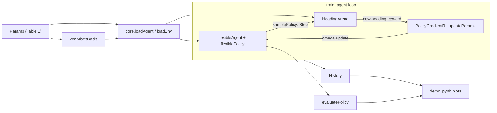
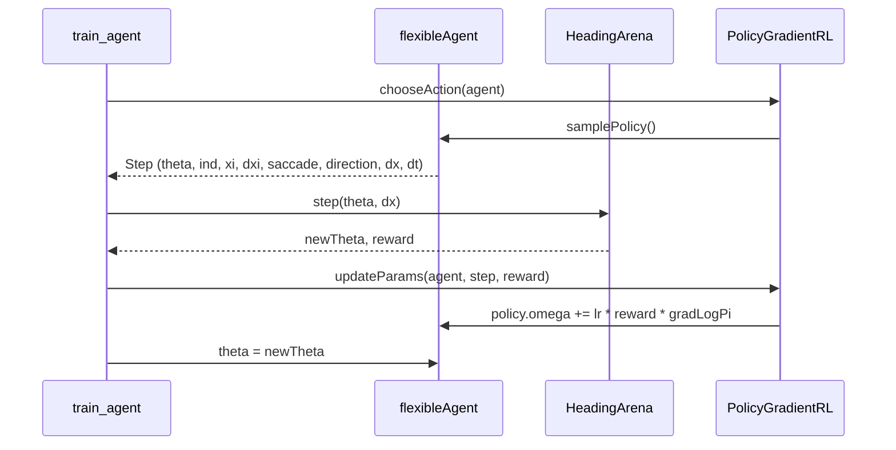

# High-level design: explRL full demo

## Overview

The demo is a loop between an agent and an arena. On each step the agent samples a fixation or a saccade from its policy. The arena moves the agent and returns a reward. The learning rule then nudges the policy weights so that rewarded actions become more likely at that heading.

## Modules

Each module is one nbdev notebook that exports one Python file. New ones are marked "new".

| Notebook | Exports | Responsibility |
|----------|---------|----------------|
| `nbs/params.ipynb` (new) | `explRL/params.py` | `Params` dataclass with Table 1 defaults |
| `nbs/basis.ipynb` (new) | `explRL/basis.py` | `vonMisesBasis` builds the `(nb, nx)` basis matrix |
| `nbs/agents.ipynb` | `explRL/agents.py` | `flexiblePolicy`, `flexibleAgent` (sampling, `Step` record), `PolicyGradientRL` (gradient and update) |
| `nbs/envs.ipynb` | `explRL/envs.py` | `HeadingArena`: wrap-around movement and Eq. 19 reward |
| `nbs/train.ipynb` | `explRL/train.py` | `train_agent`, `History`, `evaluatePolicy`, `runMany`, `residency` |
| `nbs/00_core.ipynb` | `explRL/core.py` | `loadAgent`, `loadEnv` build ready-to-use objects |
| `nbs/demo.ipynb` (new) | nothing | The demo itself: runs training and draws the plots |

Dependency direction (no cycles): `params` and `basis` depend on nothing; `agents` and `envs` use `numpy` only; `train` uses `agents` and `envs`; `core` uses all of them; `demo` uses `core` and `train`.

## Key design decisions

### D1. Heading is continuous, in radians (decided: Q4)

The heading `theta` is a float in `[0, 2*pi)`. Saccade sizes are converted from degrees to radians and are not rounded; this replaces the Phase 1 `* 96/360` and `round(dx)`, which mixed arena units into a radians heading. The basis matrix keeps one column per arena position (`nx = 96`), and the Phase 1 `_heading_index` picks the nearest column for each lookup. The reward and the plots use the continuous heading directly.

This keeps the Phase 1 heading code and tests, and changes only how `dx` is computed.

### D2. Time is counted in samples of `delT = 1 ms`

A fixation step lasts 1 sample; a saccade lasts `dtS = round(tS / delT) = 320` samples. This matches the existing `dt` values in `samplePolicy`. Seconds are used only at the edges (run length, plots).

### D3. The learning rule lives in an RL class, not in the agent

`flexibleAgent` only samples actions and reports what happened (`Step`). `PolicyGradientRL` turns a `Step` and a reward into a weight update. This keeps the existing `Agent` / `RL` split, and lets the future circuit model plug in a Hebbian RL class without changing the agent.

### D4. Every step returns a `Step` record

The gradient needs values from before the step (the integrator `xi` and the heading). Returning a small dataclass avoids reading half-updated agent state, and makes tests easy to write.

### D5. One random generator per agent

The agent owns `rng = np.random.default_rng(seed)`, which replaces the global `np.random` calls. This makes runs reproducible (NFR-1) and lets several runs use different seeds.

### D6. Slow checks use an nbdev test flag

The acceptance checks that need many full-length runs (AC-5 to AC-8) are put in cells marked `#| slow`. Adding `slow` to `tst_flags` in `pyproject.toml` makes `nbdev-test` skip them by default; `nbdev-test --flags slow` runs them.

### D7. Plotting code stays in the demo notebook

Plots are only needed by the demo, so `matplotlib` stays out of the library's dependencies (NFR-4). If plots are needed elsewhere later, they can move into an `explRL/plots.py`.

## Data flow for one step

## Risks

| Risk | Effect | Mitigation |
|------|--------|------------|
| Learning does not converge with the paper's values (missing MATLAB details; no MATLAB reference, Q6) | AC-5 / AC-6 fail | Follow the tuning order in task T12; record what was changed in the demo summary |
| Saccade gradient divides by `1 - P(fixate)`, which is tiny | Huge updates, `nan` | Clamp probabilities (NFR-7); add a test that 240 s runs stay finite |
| 240 000 Python-level steps per run are slow | Demo takes too long | Keep the step code to scalar math; default to 20 runs. Measured: about 1.8 s per 240 s run, 35 s for 20 runs |
| Changing `samplePolicy`'s return value and `dx` units breaks Phase 1 tests and docs | Red CI | Update tests and README in the same task (T3) |
| Nearest-column lookup makes the policy piecewise constant in 3.75 degree steps | Slightly coarser policy than a continuous basis | Acceptable for the demo; a continuous basis evaluation is a later option |

## Future extensions (not in this demo)

- `prestructuredAgent` with goal-heading policy and bump jumps (SI Eqs. 20-25); specified in [specs/prestructured/](../prestructured/README.md).
- `CircuitRL` with Hebbian compass and goal weights (SI Eqs. 26-39, Algorithms 3-4).
- Safe and danger zones and PI score (Eq. 40), to reproduce Figs 3-5.
