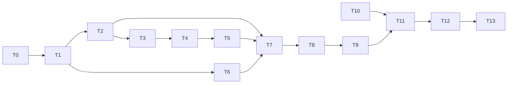

# Tasks: explRL full demo

Status: all tasks done (2026-10-10). T12 needed no tuning; results are in [README.md](README.md#results) and the demo summary.

Rules for every task:

- Write code and tests in the notebook, then run `nbdev-export` and `nbdev-test` (with `.venv/bin` first on `PATH`).
- A task is done only when its tests pass and all earlier tests still pass.
- Keep each notebook's exported file under about 200 lines.

## Order

## T0. Confirm open decisions (done)
- **What**: get answers to Q1-Q7 in [README.md](README.md).
- **Done when**: answers are written into the README's decisions table. Done on 2026-10-10.

## T1. Parameters module
- **Files**: new `nbs/params.ipynb` (exports `explRL/params.py`).
- **What**: `Params` dataclass with Table 1 defaults, `dtS` property, input checks (design-low-level section 1).
- **Tests**: defaults equal Table 1; `Params().dtS == 320`; overriding a field works; bad values (`nx=0`, wrong `wParams` length) raise `ValueError`.
- **Covers**: FR-1, FR-2.

## T2. Basis functions
- **Files**: new `nbs/basis.ipynb` (exports `explRL/basis.py`).
- **What**: `vonMisesBasis(nb, nx, kappa)` (section 2).
- **Tests**: shape `(16, 96)`; max value 1; peak positions; even tiling; bad inputs raise `ValueError`.
- **Covers**: FR-3.

## T3. Agent: radians turns, own RNG, `Step` record
- **Files**: `nbs/agents.ipynb`, `nbs/index.ipynb`.
- **What**: add `Step` (including the basis column `ind`); store `theta` wrapped into `[0, 2*pi)`; keep `_heading_index`; compute saccade `dx` in radians without rounding (drop `* 96/360` and `round(dx)`); add the `rng` argument and use it everywhere; `samplePolicy` returns `Step`; require exactly 6 `wParams` (section 3).
- **Tests**: keep the Phase 1 heading wrap-around tests; fixation keeps `dx == 0.0` and `dt == 1`; saccade gives `dt == dtS`, a non-integer `dx` in radians, and resets the integrator; `Step.ind == _heading_index(nx)`; a starting `theta` of `-0.1` is stored as `2*pi - 0.1`; same seed gives the same sequence of steps.
- **Also**: update the README example in `index.ipynb` to the new API.
- **Covers**: FR-4 to FR-7, AC-4 (partly).

## T4. Policy gradient math
- **Files**: `nbs/agents.ipynb`.
- **What**: `sigmoidGrad`; `PolicyGradientRL.gradLogPi` with probability clamping (section 3 table).
- **Tests**: `sigmoidGrad` matches a finite difference of `sigmoid`; `gradLogPi` matches a finite difference of `log pi` for a fixation, a CW saccade and a CCW saccade (AC-2); gradients stay finite when `PF` is close to 0 or 1.
- **Covers**: FR-11, NFR-7.

## T5. Policy gradient update
- **Files**: `nbs/agents.ipynb`.
- **What**: `PolicyGradientRL.chooseAction` and `updateParams` (FR-12, FR-13). The base `RL` still raises `NotImplementedError`.
- **Tests**: positive reward after a CW saccade raises `pR` at that heading, negative reward lowers it (AC-3); zero reward leaves `omega` unchanged.
- **Covers**: FR-12, FR-13, AC-3.

## T6. Arena environment
- **Files**: `nbs/envs.ipynb`.
- **What**: give `World.__init__` a `size` argument; add `HeadingArena` with `angle`, `distance`, `reward` (Eq. 19) and `step` (section 4).
- **Tests**: reward at the goal is `pi/20`; reward is lowest at the opposite heading; symmetry around the goal; wrap-around in `step` in both directions; a goal of `-pi/2` is stored as `3*pi/2`.
- **Covers**: FR-8 to FR-10.

## T7. Builders in `core`
- **Files**: `nbs/00_core.ipynb`.
- **What**: real `loadAgent(params, goal, seed)` and `loadEnv(params, goal)` (section 6).
- **Tests**: the agent's weights have length `2 * nb` with the right starting values; `fk` has shape `(nb, nx)`; the starting heading is one of the `nx` evenly spaced headings and is the same for the same seed; the RL object's `lr` equals `Params.lr`; default goal is `pi`.
- **Covers**: FR-18.

## T8. Training loop
- **Files**: `nbs/train.ipynb`.
- **What**: `History` and `train_agent` (section 5). Remove the `NotImplementedError` stub.
- **Tests**: a 2 s run finishes, has at least one saccade (use a low `aF` if needed), the sum of `History.dt` reaches the run length, weights stay finite; same seed gives an identical `History` (AC-4).
- **Covers**: FR-14, AC-4.

## T9. Evaluation helpers
- **Files**: `nbs/train.ipynb`.
- **What**: `evaluatePolicy`, `runMany`, `residency` (section 5).
- **Tests**: `evaluatePolicy` arrays have length `nx`, with `fixDur > 0` and `turnBias` in `[-1, 1]`; with all-zero saccade weights the turn bias is the same at every heading; `residency` of a history that never leaves the goal is 1 in every bin, and a saccade step counts `dtS` times as much as a fixation step; `runMany(nRuns=2, Ttot=1)` returns 2 dicts with keys `eval`, `residency`, `omega`.
- **Covers**: FR-15 to FR-17.

## T10. Configuration
- **Files**: `pyproject.toml`.
- **What**: `tst_flags = "notest slow"` under `[tool.nbdev]`; add `matplotlib` to the `dev` extras; reinstall the venv.
- **Done when**: a cell marked `#| slow` is skipped by `nbdev-test` and run by `nbdev-test --flags slow`.

## T11. Demo notebook
- **Files**: new `nbs/demo.ipynb`.
- **What**: the sections in design-low-level section 7. Quick cells run in normal tests; full-length cells are marked `#| slow`.
- **Done when**: `nbdev-test` passes in under 60 s (NFR-2), and the whole notebook runs top to bottom in under 10 minutes (NFR-3).
- **Covers**: FR-19.

## T12. Acceptance run and tuning
- **What**: run `nbdev-test --flags slow`. If AC-5 to AC-8 fail, try in this order: check the gradient signs, lower `lr`, lengthen `Ttot`, and only then revisit the basis scaling decided in Q1 (ask the user first). Write down every change and its reason in the demo summary.
- **Done when**: AC-5 to AC-8 pass, or the failure is explained in the summary and raised with the user.

## T13. Docs and wrap-up
- **Files**: `nbs/index.ipynb`, `nbs/sidebar.yml`, the plan doc.
- **What**: describe the demo and how to run it in the index (and so in the README); run `nbdev-readme` and `nbdev-sidebar`; mark the spec status as implemented.
- **Done when**: the README shows how to run the demo, and the docs sidebar lists the new notebooks.

## Traceability

| Requirement | Tasks |
|-------------|-------|
| FR-1, FR-2 | T1 |
| FR-3 | T2 |
| FR-4 to FR-7 | T3 |
| FR-8 to FR-10 | T6 |
| FR-11 | T4 |
| FR-12, FR-13 | T5 |
| FR-14 | T8 |
| FR-15 to FR-17 | T9 |
| FR-18 | T7 |
| FR-19 | T11 |
| NFR-1 | T3, T8 |
| NFR-2, NFR-3 | T10, T11 |
| NFR-4 | T10 |
| NFR-7 | T4, T8 |
| AC-1 to AC-4 | T1 to T9 |
| AC-5 to AC-8 | T12 |
