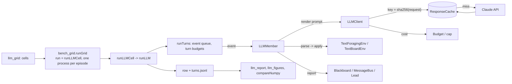

# High-level design: Phase 10, language-model agents (Claude API)

## Components

The plan named `explRL/llm_env.py` and `explRL/llm_agent.py`. The client, the offline stand-ins, the task board, the text board, runs, the numpy comparison, reporting and figures get their own modules to keep each file under 200 lines.

| Module | New / changed | Contents |
|---|---|---|
| `nbs/llm_client.ipynb` -> `explRL/llm_client.py` | new | `LLMClient`, `LLMReply`, `ResponseCache`, `Budget`, `BudgetExceeded`, `PRICES`, `TOKEN_PROFILE`, `estimateCost`, `costOf`, `requestKey`, `loadEnvFile` (since the [speedup work](../speedup/README.md): `PRICES`, `TOKEN_PROFILE`, `costOf`, `estimateCost`, `Budget`, `BudgetExceeded` live in `explRL/llm_budget.py`) |
| `nbs/llm_fake.ipynb` -> `explRL/llm_fake.py` | new | `FakeClient`, `fakeReply` (offline stand-ins) |
| `nbs/taskboard.ipynb` -> `explRL/taskboard.py` | new | `Puzzle`, `makePuzzle`, `TaskBoardEnv` (world protocol, rewards, references), `TaskBoardSim` (numpy solve-probability version) |
| `nbs/board_agents.ipynb` -> `explRL/board_agents.py` | new | `ClaimBoard`, `BoardLead`, `BoardBandit` (the numpy board agent) |
| `nbs/llm_env.ipynb` -> `explRL/llm_env.py` | new | `locationNames`, `TextForagingEnv` (rules, observation, parsing, reports), the two action schemas |
| `nbs/llm_board.ipynb` -> `explRL/llm_board.py` | new | `TextBoardEnv`: the task board behind the same text interface |
| `nbs/llm_agent.ipynb` -> `explRL/llm_agent.py` | new | `LLMMember` (prompt rendering, memory, reports, turn log), `elicitBeliefs`, `BoardLiar`, `ScriptedLiarText`, `runTurns` (turn-limited event loop) |
| `nbs/llm_runs.ipynb` -> `explRL/llm_runs.py` | new | `LLMConfig`, `setup`, `taskMetrics`, `llmStats`, `runLLM`, `makeClient`, `cellRow`, `runLLMCell` |
| `nbs/llm_compare.ipynb` -> `explRL/llm_compare.py` | new | `runNumpy`, `runNumpyCell`, `rankAvg`, `spearman`, `compareNumpy` |
| `nbs/llm_grid.ipynb` -> `explRL/llm_grid.py` | new | `SETTINGS`, `ANALYSIS_PLAN`, `planHash`, the grids, `numpyGrid`, `quickGrid`, `GRIDS`, `withClient`, `runAnyCell`, `estimateGrid` |
| `nbs/llm_report.ipynb` -> `explRL/llm_report.py` | new | summaries and `report.md` |
| `nbs/llm_figures.ipynb` -> `explRL/llm_figures.py` | new | the five figures |
| `nbs/demo_llm.ipynb` | new | quick (fake client), pilot (`llm_pilot`), main grids and arms (`llm`) |
| `nbs/demo_multiagent.ipynb` | new | the plan's write-up (decision L20): `results/multiagent/REPORT.md` and `results/multiagent/report/*.png` from the saved Phase 8-10 results |
| `.gitignore` | changed | `.env.local`, `.env.*.local` |
| `pyproject.toml` | changed | optional extra `llm = ['anthropic']`; `tst_flags` gains `llm llm_pilot` |

Import rule: only `llm_client` imports `anthropic`, and only inside `LLMClient.__init__` when no transport is given, so `import explRL` and every offline test work without it. `taskboard` imports `multi`; `board_agents` imports `harness`, `multi`, `taskboard`, `team_agents`; `llm_env` imports `harness`, `board_agents`; `llm_board` imports `harness`, `board_agents`, `llm_env`; `llm_agent` imports `multi`, `harness`, `board_agents`, `adversary` (the liar rule); `llm_fake` imports nothing from the package; `llm_runs` imports `llm_client`, `llm_fake`, `llm_agent`, `llm_env`, `llm_board`, `taskboard`, `board_agents`, `harness`, `harness_runs`, `bench_metrics`, `bench_grid` (`rowKey`), `multi`, `team_refs`; `llm_compare` imports `llm_runs`, `llm_agent`, `board_agents`, `harness_runs`, `adversary`, `multi`; `llm_grid` imports `llm_runs`, `llm_compare`, `llm_client`; `llm_report` imports `bench_stats`, `llm_compare`; `llm_figures` imports `llm_report` and `matplotlib`. No module imports a demo.

## Data flow

## Main decisions

**D1. Stateless turns (L4).** Each request is the cached rules plus one user message holding the rendered history and the observation. Replaying assistant turns would resend thinking blocks; on these models editing an earlier turn (which a sliding memory window does) invalidates them, and on newer accounts returns an error. Rendering history as text sidesteps this, makes every memory setting a pure rendering choice, and keeps the request a pure function of the state, which is what the cache key needs. The history is appended one block per turn, so prompt caching still covers the growing prefix. Rejected: a multi-turn conversation per agent (history edits for the window and notes settings, larger requests).

**D2. The cache is the reproducibility mechanism (L3).** These models reject temperature and other sampling settings. The plan's "temperature 0 where the model allows it" is therefore not available; the response cache, keyed by the full request, gives exact and free reruns, and the report states that live reruns differ.

**D3. Structured outputs, fixed schemas (L5).** A JSON schema in `output_config.format` guarantees parseable output without forced tool calls (rejected by Sonnet 5.5). The schema is the same every turn, so the cached prefix does not change with the state; names are checked in code, and anything unusable becomes a counted "stay" or "wait", the honest record of how often the model fails the interface.

**D4. No refusal fallback (L6).** A fallback would answer a refused turn with another model and blur the model-size comparison. Refusals are unlikely in these tasks; each is recorded.

**D5. Money is a hard constraint (L2, L17).** A cap the user sets, a pre-run estimate from token counts, a running total from `usage`, and a refusal to send past the cap. The pilot measures real tokens per turn before the main runs are sized.

**D6. Same worlds, same metrics (L7, L12).** Text foraging is `benchWorld` with names; the task board produces a Phase 6-style ledger and its own references; channels are the Phase 7 objects. That is what makes the numpy-vs-LLM comparison over identical cells meaningful.

**D7. Voluntary sharing (L9).** Numpy agents write every stay to the board; LLM agents choose whether to report. This makes the framing arm meaningful (does a team-score framing make agents share and explore more?) and is recorded as the share of turns with a report.

**D8. Scripted adversary, numpy coordinator (L9, L15).** The liar and the lead are deterministic code, so the only stochastic, costly component is the LLM agents being studied.

## Risks

| Risk | Effect | Mitigation |
|---|---|---|
| Costs higher than estimated (long prompts, thinking tokens) | Cap reached before the grids finish | Pilot measures tokens per turn; estimate checked per run before sending; grids ordered by priority (main text foraging and task board first); prompt caching; `effort = low` |
| Rate limits | Slow runs, retries | SDK retries 429 and 5xx; concurrency configurable; the cache makes interrupted runs resumable at no cost |
| The task board is too easy or too hard | No dynamic range | Pilot sets the difficulty for a 30-70% solo solve rate (plan Q7). Outcome: no level reached the band (Haiku 5.5 solves or runs out of tokens); difficulty 8 at solve rate 0.89, so the board tests duplicate work |
| Invalid actions dominate | Measures the interface, not coordination | Structured outputs; invalid-action rate reported per cell; pilot tunes the prompt until it is low |
| Live nondeterminism | Results not reproducible live | The response cache; 5 seeds; variance reported |
| Model-size result underpowered (3 seeds) | Wide CIs | Stated as directional (plan part 2) |
| Prices or model behaviour change | Estimates wrong | Prices dated in config and re-checked in T7 (the main runs followed the same day); model IDs fixed in config |
| An API key leaks | Security | Key only from the environment, the SDK profile or the git-ignored `.env.local`; never logged, cached or written; tests check the cache, the ledger and the quick outputs for key-like strings |
