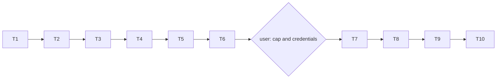

# Tasks: Phase 10, language-model agents (Claude API)

Status: all tasks done (2026-10-12): credentials from the git-ignored `.env.local`; pilot in two rounds; main runs 47 988 calls, $32.68; cached reruns byte-identical; deliverable written. See the README.

Rules for every task:

- Write code and tests in the notebook, then run `nbdev-export` and `nbdev-test --n-workers 0` (one notebook per call when naming notebooks; `.venv/bin` first on `PATH`).
- A task is done only when its tests pass and all earlier tests still pass, including every recorded hash (Phases 5, 6, 8, 9).
- Keep each exported file under about 200 lines.
- Section numbers below refer to [design-low-level.md](design-low-level.md).
- Normal tests never call the API: they use `FakeClient` and run without the `anthropic` package.
- **Two gates:** T7 needs the user's confirmed spending cap and working credentials before any live request; T9 needs the committed analysis plan.

## Order

## T1. Baseline after Phase 9
- **Files**: new `tools/phase9_baseline.sh`; output `results/multiagent/baseline_phase9/` (gitignored).
- **What**: from a clean worktree, run `tools/phase8_baseline.sh` and `demo_safety` quick; record those hashes and the hash of `safety/quick/runs.csv`.
- **Done when**: `sha256.txt` holds them and a second run gives the same.

## T2. Packaging and API client
- **Files**: `pyproject.toml` (extra `llm`, test flags); new `nbs/llm_client.ipynb` (exports `explRL/llm_client.py`).
- **What**: `PRICES`, `TOKEN_PROFILE` (provisional), `estimateCost`, `LLMReply`, `ResponseCache`, `Budget`, `BudgetExceeded`, `LLMClient`, `FakeClient` (section 2).
- **Tests**: **AC-2**; the package imports without `anthropic` (run the notebook's tests in an environment without it, or with the import blocked); cache files and the spend ledger contain no key-like strings.

## T3. Task board
- **Files**: new `nbs/taskboard.ipynb` (exports `explRL/taskboard.py`).
- **What**: `makePuzzle`, `TaskBoardEnv` (with the three reward schemes), `ClaimBoard`, `BoardLead`, `TaskBoardSim`, `socialOptimum` (section 4).
- **Tests**: **AC-4**; a puzzle's stated answer satisfies its checker at every difficulty; `TaskBoardSim` with solve rate 1 and one agent solves every task it opens.

## T4. Text foraging
- **Files**: new `nbs/llm_env.ipynb` (exports `explRL/llm_env.py`).
- **What**: `locationNames`, `TextForagingEnv`, the two schemas, `parseForage`, `parseBoard` (section 3).
- **Tests**: **AC-3**; the rules text is at least 512 tokens by a conservative character estimate (the prompt-cache minimum).

## T5. Agents
- **Files**: new `nbs/llm_agent.ipynb` (exports `explRL/llm_agent.py`).
- **What**: `LLMMember`, `ScriptedLiarText`, `elicitBeliefs`, `runTurns` (section 5).
- **Tests**: **AC-5**; every agent makes exactly its turn budget; with the same `FakeClient` script, two runs give identical logs.

## T6. Runs, grids and the quick demo
- **Files**: new `nbs/llm_runs.ipynb`, `nbs/llm_grid.ipynb`, `nbs/demo_llm.ipynb` (quick section), `nbs/sidebar.yml`.
- **What**: `LLMConfig`, `runLLM`, `runLLMCell`, `runNumpy`, `runNumpyCell`, `compareNumpy`, the grids, `numpyGrid`, `estimateGrid`, a provisional `ANALYSIS_PLAN` (sections 6, 7, 9).
- **Tests**: **AC-6**; `estimateGrid` reproduces the section 7 call counts; `runNumpyCell` runs a numpy cell of each task.
- **Done when**: tests pass; the estimated cost of every grid is printed with the provisional token profile.

## Gate: spending cap and credentials (user)
- **Cap confirmed by the user: $150 (2026-10-11).** Before T7, set it in config and check that credentials are available (`ant auth status`, `ANTHROPIC_API_KEY`, or `ANTHROPIC_API_KEY` in the git-ignored `.env.local`); ask the user only if none is found. No live request is made before this.

## T7. Pilot (live, small)
- **What**: re-check model IDs and prices against the current documentation; run `--flags llm_pilot` with `EXPLRL_LLM_LIVE=1` (about 1 000 Haiku and 100 Sonnet calls, a few dollars); choose the task-board difficulty (Haiku 5.5 solo solve rate in 30-70%), the effort (low unless it drops the solve rate out of the band), `maxTokens` (fewer than 2% of turns stop at `max_tokens`), and `TOKEN_PROFILE`; tune the prompts until invalid actions are below 5% of turns; re-estimate every grid against the cap.
- **Done when**: **AC-7**: the choices and measurements are recorded in the README; *(check)* marks removed; `ANALYSIS_PLAN` final; spec, code and README committed, with the commit and the plan hash written into the README.

## T8. Report
- **Files**: new `nbs/llm_report.ipynb` (and a figures notebook if needed); `nbs/demo_llm.ipynb` (pilot and main sections).
- **What**: summaries, figures and `report.md` (FR-14, section 9).
- **Tests**: the quick demo writes every artifact with fake data; the report shows the plan hash, the models, the prices with their date and the cost.

## T9. Main runs (live)
- **What**: run `--cell-timeout 0 --flags llm` with `EXPLRL_LLM_LIVE=1`, grids in priority order (main, Sonnet, budget, liar, framing, memory, persistence) so that a cap reached late costs the least important arms.
- **Done when**: **AC-8**: every grid has run within the cap (or the README states which did not and why); cost, calls, cache hits and wall time recorded; findings in the README, labelled exploratory.

## T10. Rerun check, regression and docs
- **What**:
  - rerun `--flags llm` with the cache present: no live request, zero cost, byte-identical outputs (**AC-9**);
  - run the full suite (with and without `anthropic` installed) and every baseline from T1 (**AC-1**);
  - write `specs/multiagent/phase10/RUN.md`; set this spec's status to implemented with the results and a plain-language figure guide; mark Phase 10 done in [../README.md](../README.md) with decisions Q6 and Q7, and write the plan's deliverable (`nbs/demo_multiagent.ipynb`, `results/multiagent/REPORT.md`; decision L20) from the saved Phase 8-10 results, without rerunning anything;
  - link `nbs/demo_llm.ipynb` and `RUN.md` from `nbs/index.ipynb`, `README.md` and the other multi-agent `RUN.md` files.
- **Done when**: all checks pass and the docs are updated.

## Acceptance criteria to task map

| AC | Task |
|----|------|
| AC-1 | T2, T10 |
| AC-2 | T2 |
| AC-3 | T4 |
| AC-4 | T3 |
| AC-5 | T5 |
| AC-6 | T6 |
| AC-7 | T7 |
| AC-8 | T9 |
| AC-9 | T10 |
