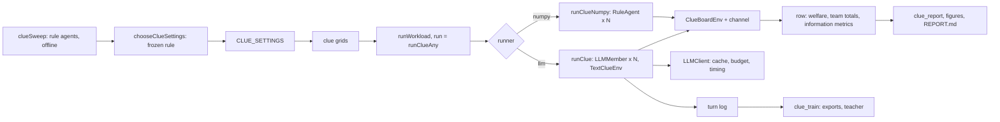

# High-level design: Phase 11, the clue board

## Components

| Module | New / changed | Contents |
|---|---|---|
| `nbs/cluetask.ipynb` -> `explRL/cluetask.py` | new | `PRIMES`, `CLUE_PAIRS`, `primeSets`, `ClueTask`, `makeClueTask` (the clues; split from the board to keep modules under 200 lines) |
| `nbs/clueboard.ipynb` -> `explRL/clueboard.py` | new | `Subtask`, `ClueBoardEnv` (world protocol, dealing, share and solve logs, rewards, `pooledBound`) |
| `nbs/clue_agents.ipynb` -> `explRL/clue_agents.py` | new | `ClueBoard`, `ClueMessages`, `ClueLead` (channels carrying clues; `known(i, board)` per agent), `candidates`, `RuleAgent`, `ClueLiar` |
| `nbs/clue_text.ipynb` -> `explRL/clue_text.py` | new | `CLUE_SCHEMA`, `TextClueEnv` (rules, observation, parsing, posting shares, history lines) |
| `nbs/clue_runs.ipynb` -> `explRL/clue_runs.py` | new | `clueSetup`, `clueMetrics`, `runClue`, `runClueNumpy`, `runClueAny` (dispatch for `runWorkload`) |
| `nbs/clue_grid.ipynb` -> `explRL/clue_grid.py` | new | `CLUE_SETTINGS`, `CLUE_PLAN`, `clueHash`, `clueSweep`, `sweepIncentives`, `chooseClueSettings`, `cluePilotGrid`, `clueMainGrid`, `clueFramingGrid`, `clueLiarGrid`, `clueEffortGrid`, `clueScaleGrid`, `clueNumpyGrid`, `clueQuick` |
| `nbs/clue_train.ipynb` -> `explRL/clue_train.py` | new | `ClueEpisodes`, `exportTrajectories`, `teacherAction` (Part D) |
| `nbs/clue_report.ipynb` -> `explRL/clue_report.py` | new | summaries, `report.md`, figures |
| `nbs/llm_budget.ipynb` -> `explRL/llm_budget.py` | changed | `TOKEN_PROFILE` entries for the `'clue'` task (provisional, then measured in the pilot) |
| `nbs/llm_runs.ipynb` -> `explRL/llm_runs.py` | changed | `runLLMCell(cell, run=None)`: optional run function (default `runLLM`) |
| `nbs/llm_fake.ipynb` -> `explRL/llm_fake.py` | changed | `fakeReply`: a clue-board branch that sometimes shares an own clue |
| `nbs/bench_grid.ipynb` -> `explRL/bench_grid.py` | changed | `writeCSV` writes tuple values as `a|b|c` (earlier outputs unchanged) |
| `nbs/demo_clue.ipynb` | new | quick (fake), sweep (`slow`), pilot and main (`llm`) |
| `nbs/sidebar.yml` | changed | the new notebooks |

Import rule: `cluetask` imports nothing from the package; `clueboard` imports `cluetask` and `multi` (seeded generators); `clue_agents` imports `team_agents` (`PatchMember`) and `multi` (it reads the board through its methods); `clue_text` imports `clue_agents`; `clue_runs` imports `clueboard`, `clue_agents`, `clue_text`, `llm_agent` (`LLMMember`, `runTurns`), `llm_runs` (`LLMConfig`, `cellRow`, `llmStats`, `runLLMCell`), `llm_budget`, `team_time`, `team_refs`, `multi`, `llm_grid` (`runAnyCell` for non-clue cells); `clue_grid` imports `cluetask`, `llm_grid` (`llmCell`), `llm_budget`; `clue_train` imports `clueboard`, `clue_agents`, `clue_text`, `multi`; `clue_report` imports `llm_report`, `llm_figures`, `llm_compare` (`compareNumpy`). Only `llm_client` imports `anthropic` (unchanged). No module imports a demo. Phase 10 and follow-up modules are not changed except the token profile, `runLLMCell`'s optional run function, the fake client's clue branch and the CSV writer's tuple format (all backward compatible: earlier outputs are byte-identical).

## Data flow

## Main decisions

**K-H1. Same structure as the Phase 10 board.** The clue board keeps the Phase 10 board's world protocol, scoring, expiry and ledger, so team totals, the scheduler, caching and the text-member machinery carry over; what changes is where information lives. Rejected: a fresh environment design (more code, weaker comparison with Phase 10).

**K-H2. Modular clues (K1).** Exact, seedable, uniquely solvable, combinable mentally, checkable by our code, with difficulty in information rather than computation (`R` and the primes keep the arithmetic small). Rejected: logic-grid clues (richer, but harder to generate with unique answers and to check), free-text facts (cannot be checked exactly).

**K-H3. Sharing is an action with a cost (K4).** A share takes the agent's turn, so sharing competes with working and the incentive problem is real; it is also what the training package rewards (credit reward). Relaying a seen clue is allowed (it matters with messages); the share carries its residue, so the board can log false shares, while knowing whether an agent knows a clue stays with the agent or adaptor, which see the channel. Rejected: free sharing alongside every action (removes the trade-off).

**K-H4. Channels route information, not claims (K5).** The blackboard pools everything; messages reach two random teammates; the coordinator routes to whoever has the subtask open and points agents at nearly complete subtasks. This turns the Phase 7 comparison into a comparison of information-routing architectures.

**K-H5. Offline sweep with a frozen rule before any spend (K3).** The numpy rule agents test the board's dynamic range and fix its settings; the live pilot then only checks that Haiku can combine clues and use the interface. Rejected: a live difficulty pilot as in Phase 10 (its result was a board without range).

**K-H6. Reuse runners through `cfg.task = 'clue'`.** Cells keep `runner` `'llm'` / `'numpy'`, so `withClient`, `orderCells`, `checkWorkload` and `estimateGrid` work unchanged; `runClueAny` dispatches clue cells to the new runners and everything else to `runAnyCell`. Rejected: new runner names (would need changes in the scheduler).

**K-H7. Training-ready, not trained (K10).** Part D adds what RL needs (batched episodes, rewards, exports, a teacher) so the next phase can train without touching the environment.

## Risks

| Risk | Effect | Mitigation |
|---|---|---|
| Haiku cannot combine the clues reliably | Solves fail even with all clues | Pilot check (AC-9: at least 80% with all clues known); `R` up to 210 keeps the arithmetic small; worked example in the rules |
| The board lacks dynamic range again | No channel effect | Offline sweep with a frozen rule; the phase stops if no setting qualifies |
| Agents guess instead of sharing | Measures luck | Penalty for wrong answers; at least two candidates without each clue; guesses counted |
| Share spam | Wasted turns | Shares cost a turn; redundant shares measured |
| Longer observations (clue lists) raise cost | Over budget | Token profile measured in the pilot; estimate checked against the cap before the main runs |
| Prompt cache prefix changes | Lower cache hit rate | Rules and schema fixed per run; history append-only (as Phase 10) |
