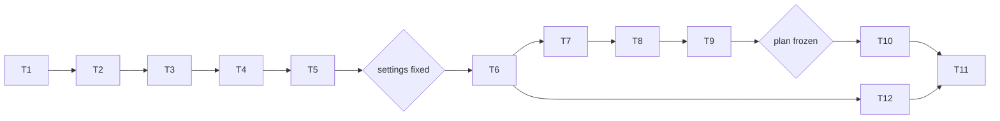

# Tasks: Phase 11, the clue board

Status: not started (spec drafted 2026-10-12).

Rules for every task:

- Write code and tests in the notebook, then run `nbdev-export` and `nbdev-test --n-workers 0` (one notebook per call when naming notebooks; `.venv/bin` first on `PATH`); after `nbdev-export`, restore modules whose only change is the cell-id comments.
- A task is done only when its tests pass and all earlier tests still pass, including the Phase 5-9 baselines and the Phase 10 and follow-up reference outputs (cached reruns byte-identical).
- Keep each exported file under 200 lines.
- Section numbers below refer to [design-low-level.md](design-low-level.md).
- Normal tests never call the API (fake client) and run without `anthropic`.
- **Gates:** no live call before the sweep has fixed `CLUE_SETTINGS` (T5); no main live run before `CLUE_PLAN` is frozen and committed (T9); the $150 cap (spent $40.60) is enforced by `runWorkload`.

## Order

## T1. Baselines and references
- **What**: from a clean worktree of `main`, `tools/phase9_baseline.sh`; record the hashes of the Phase 10 and follow-up full outputs (`results/multiagent/llm/full`, `results/multiagent/followup/full`: `runs.csv`, `turns.jsonl`).
- **Done when**: the baseline matches `results/multiagent/baseline_phase9/sha256.txt`; the reference hashes are written down.

## T2. Clues and the board
- **Files**: new `nbs/cluetask.ipynb` (section 1), new `nbs/clueboard.ipynb` (section 2).
- **What**: `PRIMES`, `CLUE_PAIRS`, `primeSets`, `ClueTask`, `makeClueTask`, `ClueBoardEnv` (dealing, actions, share and solve logs, `netRows`, `holders`, `pooledBound`, rewards).
- **Tests**: **AC-2**, **AC-3**.

## T3. Channels and rule agents
- **Files**: new `nbs/clue_agents.ipynb` (section 3).
- **What**: `ClueBoard`, `ClueMessages`, `ClueLead`, `known`, `candidates`, `RuleAgent`, `ClueLiar`.
- **Tests**: **AC-4**; a liar's false clue makes a dependent answer wrong.

## T4. Runs (numpy first)
- **Files**: new `nbs/clue_runs.ipynb` (section 5); `nbs/llm_budget.ipynb` (`TOKEN_PROFILE` for `'clue'`, provisional).
- **What**: `clueSetup`, `clueMetrics`, `runClueNumpy`, `runClueAny` (numpy path; the LLM path in T6).
- **Tests**: metrics on hand-made runs (assisted solves, share-to-use time, redundant shares, `teamWelfare == welfare x N x turns`); determinism per seed.

## T5. The numpy sweep and the settings rule
- **Files**: new `nbs/clue_grid.ipynb` (section 6: `clueSweep`, `chooseClueSettings`, `CLUE_SETTINGS`); new `nbs/demo_clue.ipynb` (setup, quick numpy cells, sweep section).
- **What**: run the sweep (`--cell-timeout 0 --flags slow`), apply the frozen rule, write the chosen settings into `CLUE_SETTINGS` and the sweep's findings into the README.
- **Done when**: **AC-8**; settings fixed (gate 1). If no setting qualifies, stop and report to the user.

## T6. Text interface and LLM runs
- **Files**: new `nbs/clue_text.ipynb` (section 4); `nbs/clue_runs.ipynb` (`runClue`, the LLM path of `runClueAny`); `nbs/llm_runs.ipynb` (`runLLMCell(cell, run=None)`); `nbs/llm_fake.ipynb` (clue branch).
- **What**: `CLUE_SCHEMA`, `TextClueEnv`; `runClue` with the fake client.
- **Tests**: **AC-5**; the rules text is above 512 tokens; a fake-client team with all clues known solves; turn logs and timing written as Phase 10.

## T7. Grids, report and the quick demo
- **Files**: `nbs/clue_grid.ipynb` (all grids, `CLUE_PLAN`, `clueHash`, `clueQuick`); new `nbs/clue_report.ipynb` (section 8); `nbs/demo_clue.ipynb` (quick, pilot and main sections); `nbs/sidebar.yml`.
- **Tests**: **AC-6**; grid sizes and call estimates (section 6 table); the report shows the plan hash, settings, models, prices, cost.

## T8. Regression
- **What**: full suite with and without `anthropic`; Phase 5-9 baselines; Phase 10 and follow-up cached reruns byte-identical to T1's references.
- **Done when**: **AC-1**.

## T9. Pilot (live, about $0.2) and freezing the plan
- **What**: re-check prices; run the pilot through `runWorkload`; check **AC-9** (solve rate with all clues known at least 80%, invalid actions under 5%); measure the token profile and set `TOKEN_PROFILE[(model, 'clue')]`; re-estimate the main scope against the cap; freeze `CLUE_PLAN`, commit spec, code and README, and record the commit and hash in the README (gate 2). If AC-9 fails, stop and ask the user (prompt or settings change before freezing).

## T10. Main runs (live, about $6-8)
- **What**: `clueMainGrid`, `clueFramingGrid`, `clueLiarGrid` as one workload through `runWorkload` (priority in that order); keep a `_live` copy of `metrics.json` and `timing.jsonl`; cached rerun of the mode.
- **Done when**: **AC-10**; findings in the README, labelled exploratory. Optional arms (`clueEffortGrid`, `clueScaleGrid`) only if the user asks.

## T11. Reports and docs
- **What**: README status and results with a plain-language figure guide; `RUN.md`; `REPORT.md` section from `demo_multiagent`; the multi-agent plan's status (Phase 11 done, Part E next with its compute decision); links from `nbs/index.ipynb`, `README.md` and the multi-agent `RUN.md` files.
- **Done when**: docs updated; all checks pass.

## T12. Training package (offline; can run alongside T7-T10)
- **Files**: new `nbs/clue_train.ipynb` (section 7).
- **What**: `ClueEpisodes`, `exportTrajectories`, `teacherAction`.
- **Tests**: **AC-7**; exports from the quick demo's turn log round-trip.

## Acceptance criteria to task map

| AC | Task |
|----|------|
| AC-1 | T8, T11 |
| AC-2 | T2 |
| AC-3 | T2 |
| AC-4 | T3 |
| AC-5 | T6 |
| AC-6 | T7 |
| AC-7 | T12 |
| AC-8 | T5 |
| AC-9 | T9 |
| AC-10 | T10 |
