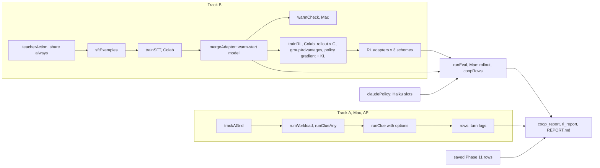

# High-level design: Phase 12, training agents to work together

## Components

| Module | New / changed | Contents |
|---|---|---|
| `nbs/clue_text.ipynb` -> `explRL/clue_text.py` | changed | `TextClueEnv(board, hint=None, showOpen=False)` (Track A options A1, A3) |
| `nbs/clue_agents.ipynb` -> `explRL/clue_agents.py` | changed | `ClueLead(n, passPooled=False)` (Track A option A2) |
| `nbs/clue_runs.ipynb` -> `explRL/clue_runs.py` | changed | `clueSetup` and `runClue` pass the Track A options from `cfg.world` |
| `nbs/clue_train.ipynb` -> `explRL/clue_train.py` | changed | `ClueEpisodes(..., seeds=None, scripted=None, text=None, passPooled=False)` and its last-turn record (with the exploration flag and summary line); `teacherAction(..., share='needed')` |
| `nbs/clue_policy.ipynb` -> `explRL/clue_policy.py` | new | `historyBlocks`, `renderPrompt`, `userText`, `parseReply`, `asReply`, `scriptedPolicy`, `claudePolicy` |
| `nbs/local_policy.ipynb` -> `explRL/local_policy.py` | new | `LocalPolicy` (Hugging Face model and LoRA adapter on cuda, mps or cpu; vLLM on cuda; reply cache), `pickDevice`, `promptText`, `encodePair`, `adapterHash` |
| `nbs/tiny_model.ipynb` -> `explRL/tiny_model.py` | new | `tinyModel`: a tiny random model and tokenizer (no download) for smoke tests of the model code |
| `nbs/clue_roll.ipynb` -> `explRL/clue_roll.py` | new | `rollout` (batched boards, one policy per slot, scripted slots, turn logs, returns), `coopRows`, `runEval` |
| `nbs/clue_sft.ipynb` -> `explRL/clue_sft.py` | new | `sftExamples`, `trainSFT`, `mergeAdapter`, `warmCheck` |
| `nbs/clue_rl.ipynb` -> `explRL/clue_rl.py` | new | `RLConfig` (including `perRole`, the per-role adapter ablation, `turnFraction` and the stopping rule's thresholds), `configHash`, `stepSeeds`, `trainingReturns`, `groupAdvantages`, `stepSamples`, `trainRL` |
| `nbs/rl_control.ipynb` -> `explRL/rl_control.py` | new | the pure control logic of the RL loop: `warmLr`, `nextLr` (the KL-targeted learning rate, P12-10), `haltReason`, `microBatches`, `nanMean` |
| `nbs/rl_torch.ipynb` -> `explRL/rl_torch.py` | new | the PyTorch side of `clue_rl`: `replyLogps`, `saveMemory`, `freeGPU`, `policyUpdate` (with an out-of-memory fallback), `probeLogps`, `probeKL`, `snapshot`, `restore`, `saveCheckpoint`, `loadCheckpoint` (split to keep `clue_rl` under 200 lines) |
| `nbs/coop_grid.ipynb` -> `explRL/coop_grid.py` | new | `trackAGrid`, `trackAPilotGrid`, `TRACKA_PLAN`, `RL_PLAN`, `coopHash`, `evalSuite` |
| `nbs/coop_report.ipynb` -> `explRL/coop_report.py` | new | Track A: `logMetrics` (follow share and solo solves from turn logs), `trackASummaries`, `writeTrackA`, `figTrackA` |
| `nbs/rl_report.ipynb` -> `explRL/rl_report.py` | new | Track B: `rlSummaries`, `writeRL`, `writeRLFigures` (split from `coop_report` to keep both under 200 lines) |
| `nbs/demo_coop.ipynb` | new | Track A: quick (fake client), pilot and main (`llm`) |
| `nbs/demo_rl.ipynb` | new | Mac: quick offline checks; debug run (0.5B), warm-start check, evaluation, cross-play, report (`train`; run from the separate training environment) |
| `nbs/colab_clue_rl.ipynb` | new | Colab: set-up, pilot, warm start, three RL runs (`gpu`) |
| `nbs/demo_multiagent.ipynb` | changed | section 8 of `REPORT.md` (Phase 12) |
| `pyproject.toml` | changed | `[train]` extra; test flags `gpu` and `train` |
| `nbs/sidebar.yml`, `nbs/index.ipynb`, `README.md` | changed | the new notebooks and links |

Import rule: `clue_policy` imports `llm_agent` (`FRAMING`), `llm_client` (`LLMReply`) and `clue_text` (`CLUE_SCHEMA`); `local_policy` imports `clue_policy` and `llm_client` (`ResponseCache`), and imports `torch`, `transformers`, `peft` and `vllm` only inside its functions; `tiny_model` imports `clue_text` and `clueboard` (and the GPU libraries) inside its function; `clue_roll` imports `clue_train`, `clue_policy`, `clue_runs` (`clueMetrics`), `clue_agents`, `llm_agent` (`_plain`), `llm_runs` (`LLMConfig`, `llmStats`, `cellRow`), `bench_grid` (`rowKey`); `clue_sft` imports `clue_train`, `clue_roll`, `clue_policy`, `clue_agents` (`known`), `clue_grid` (`CLUE_SETTINGS`), `local_policy`, `llm_runs`, `multi` (GPU libraries inside functions); `clue_rl` imports `clue_roll`, `clue_sft` (`loadModel`, `loraConfig`), `local_policy`, `rl_torch`, `clue_grid`, `llm_runs`; `rl_torch` imports `local_policy` (GPU libraries inside functions); `coop_grid` imports `clue_grid`, `clue_rl` (`RLConfig`), `clue_sft` (`SFTConfig`), `llm_budget`, `llm_grid`; `coop_report` imports `llm_report`, `llm_figures`, `bench_grid`; `rl_report` imports `llm_report`, `llm_figures`. Only `llm_client` imports `anthropic`. No module imports a demo. Phase 11 modules change only by options whose defaults leave their behaviour and outputs unchanged.

## Data flow

## Main decisions

**K-H1. One rollout engine for training, evaluation and cross-play.** `rollout` steps a batch of boards through `ClueEpisodes`, asks each slot's policy for its reply, and renders prompts exactly as `LLMMember` does; with the same replies it reproduces `runClue` (tested), so evaluation rows compare directly with the Phase 11 rows. Rejected: running local models through `runTurns` (one board at a time, so no batched generation on one GPU) and a separate engine for training (two code paths to keep equal).

**K-H2. Policies are batch functions.** A policy takes a list of prompts and returns reply texts; the scripted, Claude and local policies share that interface, so a board can mix them (cross-play) and tests run without a model. Scripted members (liars) keep acting on the board directly, as in Phase 11.

**K-H3. Notes memory for trained models; full memory for Haiku.** Notes keep the prompts short for training and evaluation (P12 plan); Haiku slots in cross-play keep Phase 11's set-up (full memory, own framing, effort low, `maxTokens` 8000) so Haiku behaves as it did there.

**K-H4. The teacher shares `'always'` for the warm start.** The Phase 11 rule agent's `'needed'` policy looks at which subtasks teammates have open, which the prompt does not show; imitating it would ask the model to copy decisions it cannot see the reasons for. With `'always'`, every teacher move depends only on what the prompt shows (own clues, the board's shared clues, turns left, values).

**K-H5. Notes first in the warm-start replies.** The model has no separate reasoning step and the reply is short, so the teacher's reply puts its note first: for a submit, the candidates left by the known clues (the rules' own method), then the action. JSON key order does not matter to the parser, so Claude's format is unchanged.

**K-H6. Merge, then train a fresh adapter.** The warm-start adapter is merged into the weights; RL trains a new adapter, and the KL reference is the same model with that adapter switched off, so no second model is held in memory.

**K-H7. On-policy, one gradient pass per step.** Each step's rollouts are used for exactly one update, so the GRPO probability ratio is 1 and no clipping is needed; the loss is the advantage-weighted log-probability of each reply plus the KL penalty. Rejected: several passes with clipping (more GPU time per step, little gain at 40 steps).

**K-H8. Track A options travel in `cfg.world`; new metrics live in `coopRows`.** Both keep every Phase 11 cell and row unchanged, so the Phase 11 cached reruns stay byte-identical.

**K-H9. Same code on the Mac and Colab.** `pickDevice` chooses cuda, mps or cpu; vLLM is used for generation only on cuda when installed (Linux), Hugging Face generation otherwise. The Mac runs the 0.5B debug runs, the warm-start check and the evaluation; Colab runs the warm start and the three RL runs with the 3B model.

**K-H10. Cached local replies.** `LocalPolicy` can cache replies keyed by model, adapter hash, prompt and sample seed (the Phase 10 `ResponseCache`), so a rerun of the evaluation is byte-identical even though GPU sampling is not.

## Risks

| Risk | Effect | Mitigation |
|---|---|---|
| The prompt drifts from `LLMMember`'s | Evaluation not comparable with Phase 11 | Tested equality of prompts and of rows against `runClue` (AC-3) |
| The model solves by trial and error | Scores without cooperation | Solo solves and wrong answers per solve reported for every model (FR-B5) |
| Warm start fails at 3B | No competent start for RL | Notes-first replies; a 7-8B check (P12-2) |
| Training runs out of GPU memory (found in the Mac debug run: full-vocabulary logits over 1 300-token prompts) | Runs fail | Loss over the reply positions only; gradient checkpointing (`gradCkpt`) |
| Colab step time too long (the pilot: 631 s per step, 7 hours per run, mostly the update over 1 280 turns) | Runs exceed a few hours | Train on a quarter of each step's turns, gradient checkpointing off on the A100, steps fixed by the RL speed check (P12-9) |
| A run degenerates (invalid replies, the model drifting far from the warm start) | Wasted GPU time, meaningless adapter | The stopping rule (FR-D5) |
| The learning rate is too small to move the policy, or so large that it swings (v1 at 1e-5: KL under 0.02 after 60 steps) | No effect, or instability | The per-step policy change is measured and the learning rate steered to a target, runaway steps undone; a learning-rate pilot sets the starting and maximum rates (P12-10) |
| vLLM and training share one GPU | Out of memory | vLLM given a fixed share of GPU memory; Hugging Face generation as fallback |
| MPS lacks an operation or is slow | Mac debug or evaluation blocked | cpu fallback for debug; evaluation on Colab with the same code |
| Mac disk nearly full (15 GB free) | Model downloads fail | Free about 15 GB in T1, before the model work of T7 |
| Track A changes break Phase 11 outputs | Frozen results change | Options default off; Phase 11 cached reruns checked (AC-1) |
