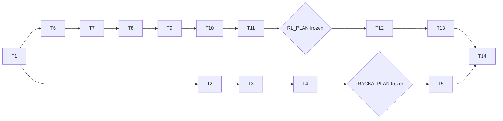

# Tasks: Phase 12, training agents to work together

Status (2026-10-13): T1-T9 done (T4-T5: Track A pilot and main runs; T7-T9: the 0.5B debug run on the Mac, AC-6). T10: code, regression and push done, the Colab pilot next; T11-T13 to follow. T14 partly done (RUN.md, links, sidebar, REPORT.md section 8 for Track A).

Rules for every task:

- **Workflow:** write code and tests in the notebook, then run `nbdev-export` and `nbdev-test --n-workers 0` (one notebook per call when naming notebooks; `.venv/bin` first on `PATH`). After `nbdev-export`, restore modules whose only change is the cell-id comments.
- **Done means no regressions:** a task is done only when its tests pass and all earlier tests still pass, including the Phase 5-9 baselines and the Phase 10, follow-up and Phase 11 reference outputs (cached reruns byte-identical).
- **Size:** keep each exported file under 200 lines; split a module rather than compress it.
- **References:** section numbers below refer to [design-low-level.md](design-low-level.md).
- **Offline tests:** normal tests never call the API or load a model, and run without `anthropic` and `torch`. Model runs sit behind `train` (Mac) and `gpu` (Colab), API runs behind `llm`.
- **Gates:**
  - no Track A main run before `TRACKA_PLAN` is frozen and committed (T4);
  - no main RL run before `RL_PLAN` is frozen and committed (T11);
  - API spend under the $150 API cap ($44.29 spent); GPU spend under the separate $150 GPU cap, each Colab run a few hours.

## Order

Track A (T2-T5) and the Track B code (T6-T9) can proceed side by side; Track A's live runs come first (P12-4).

## T1. Baselines and references
- **What**:
  - Run `tools/phase9_baseline.sh` from a clean worktree.
  - Record the sha256 of `runs.csv` and `turns.jsonl` in `results/multiagent/{llm,followup,clue}/full/`.
  - Free about 15 GB of disk on the Mac (needed from T7).
- **Done when**: the baseline matches `results/multiagent/baseline_phase9/sha256.txt`; the reference hashes are written down; at least 30 GB free.

## T2. Track A options
- **Files**: `nbs/clue_text.ipynb`, `nbs/clue_agents.ipynb`, `nbs/clue_runs.ipynb` (section 1).
- **What**:
  - `hint` and `showOpen` in `TextClueEnv`;
  - `passPooled` in `ClueLead`;
  - `suggest` before `known` in `observe`;
  - the options passed from `cfg.world`.
- **Tests**: **AC-2** (options); Phase 11 cached rerun of `results/multiagent/clue/full` byte-identical.

## T3. Track A grid and quick demo
- **Files**: new `nbs/coop_grid.ipynb` (section 8: `trackAGrid`, `trackAPilotGrid`, `TRACKA_PLAN`, `coopHash`); new `nbs/coop_report.ipynb` (Track A, section 9); new `nbs/demo_coop.ipynb` (section 10).
- **Tests**: **AC-2** (grid sizes, call estimates); the quick demo writes every artifact in under 30 s and is identical at 1 and 8 processes; the report on fake rows shows the plan hash.

## T4. Track A pilot (live, about $0.12) and freezing its plan
- **What**:
  - Re-check prices, then run `trackAPilotGrid` live.
  - Check that the invalid rate is under 5% and the new prompt lines appear.
  - Freeze `TRACKA_PLAN`, commit, and record the commit and hash in the README (gate A).
- **Done when**: **AC-8** (pilot part). If the invalid rate is 5% or more, stop and report.

## T5. Track A main runs (live, about $2.3)
- **What**: `trackAGrid` through `runWorkload`; `_live` copies; a cached rerun; the Track A report.
- **Done when**: **AC-8**; findings in the README, labelled exploratory.

## T6. Episodes, prompts and rollouts
- **Files**: `nbs/clue_train.ipynb` (section 2: `seeds`, `scripted`, `text`, `last`, `teacherAction(share=)`); new `nbs/clue_policy.ipynb` (section 3); new `nbs/clue_roll.ipynb` (section 5).
- **Tests**: **AC-3**:
  - prompts equal `LLMMember`'s;
  - `rollout` rows equal `runClue` rows with the same scripted replies, including liars and every channel;
  - repeated seeds give identical boards;
  - pending credit is included in returns;
  - one policy call per round.

  Also `followShare` and `soloSolves` on hand-made logs.

## T7. Local models on the Mac
- **Files**: new `nbs/local_policy.ipynb` (section 4); new `nbs/tiny_model.ipynb`; `pyproject.toml` (`[train]` extra, `gpu` and `train` flags); `nbs/demo_rl.ipynb` (quick and debug sections).
- **What**:
  - Install the `[train]` extra in a separate Mac environment (`.venv-train`), keeping the project environment without `torch` (AC-1).
  - Choose a candidate model family: open weights, a licence that allows research fine-tuning, a chat template, about 3B and 0.5B sizes.
  - Run the 0.5B model as `LocalPolicy` on mps through `rollout`.
  - Measure the batched generation speed of the 0.5B model and, once downloaded, the 3B model, to confirm the Mac evaluation estimate (section 8).
- **Tests**: offline: device choice, cache key, prompt text and encoding with a stub tokenizer, cache replay and independent samples with a stubbed generator. `train` flag: generation on cpu and mps with the tiny model (no download); the 0.5B model in `demo_rl` (**AC-6**).

## T8. Warm start
- **Files**: new `nbs/clue_sft.ipynb` (section 6).
- **Tests**: **AC-4** offline. `train` flag: warm start, merge and check on the tiny model (the loss falls). The 0.5B debug run (50 warm-start steps, `warmCheck` on 3 boards; no pass required) is in `demo_rl`.

## T9. RL
- **Files**: new `nbs/clue_rl.ipynb`, new `nbs/rl_torch.ipynb` (section 7).
- **Tests**:
  - Offline: **AC-5** (`groupAdvantages` on hand-made returns; the format penalty in training returns only; `stepSamples` skips zero advantages; `perRole` maps each slot to its own adapter name).
  - `train` flag: on the tiny model, shared and per-role: two RL steps with finite loss, KL 0 at the first step and above 0 after an update, resume at step 3, a mismatched configuration refused. The same with the 0.5B model in `demo_rl` (**AC-6**).

## T10. Regression and the Colab pilot
- **Files**: new `nbs/colab_clue_rl.ipynb` (section 10); `nbs/coop_grid.ipynb` (`RL_PLAN`, `evalSuite`); new `nbs/rl_report.ipynb` (Track B, section 9, tested on synthetic rows).
- **What**:
  - Run the full suite with and without `anthropic` and `torch`, plus the Phase 5-9 baselines and the Phase 10, follow-up and Phase 11 cached reruns.
  - Push the code, so Colab installs it from GitHub.
  - Run the notebook's pilot on a Colab A100 with the 3B model; record step time, peak memory and the GPU hours used.
  - If a main run would exceed a few hours, cut steps or rollouts in `RL_PLAN`. Done (pilot: 631 s per step, 7 hours per run): decision P12-9, train on a quarter of the turns, gradient checkpointing off, the stopping rule; the step count follows from the RL speed check at the start of session 2.
- **Done when**: **AC-1**, **AC-7**.

## T11. Warm start (Colab) and freezing the RL plan
- **What**:
  - Run the notebook's warm-start section on Colab (`sftExamples`, `trainSFT`) and download the adapter to the Mac; at the start of the next session, the RL speed check fixes the step count (40, or 60 if it fits a few hours).
  - Run `warmCheck` on the Mac (**AC-9**). If it fails, stop and ask the user (the 7-8B check of P12-2, or a change of plan).
  - Freeze `RL_PLAN` with the measured settings, commit, and record the commit and hash in the README (gate B).
- **Done when**: **AC-9**; gate B.

## T12. RL runs (Colab, three sessions)
- **What**:
  - Run one Colab session per reward scheme (individual, team, credit), each resuming after any disconnection.
  - Record GPU hours and cost per run in the README.
  - Zip and download the adapters, metrics and logs to `results/multiagent/rl/runs/`.
  - Add a second training seed only if the first shows a difference between schemes and the GPU cap allows.
  - Optional, if the GPU cap allows: the per-role adapter ablation under the credit reward (`perRole=True`).
- **Done when**: **AC-10**.

## T13. Evaluation and report (Mac)
- **What**:
  - Run `runEval(evalSuite(...))` with cached local replies, with the API key for the cross-play cells.
  - Write the Track B report and figures, then run a cached rerun of the evaluation.
- **Done when**: **AC-11**; findings in the README, labelled exploratory.

## T14. Docs
- **What**:
  - README status, results and a plain-language figure guide.
  - `RUN.md` covering the Mac and Colab steps, with an "Open in Colab" link.
  - `REPORT.md` section 8 from `demo_multiagent`.
  - The multi-agent plan's status and plain-language conclusions.
  - Links from `nbs/index.ipynb`, `README.md`, the Phase 11 `RUN.md` and the sidebar.
- **Done when**: docs updated; all checks pass.

## Acceptance criteria to task map

| AC | Task |
|----|------|
| AC-1 | T2, T10, T14 |
| AC-2 | T2, T3 |
| AC-3 | T6 |
| AC-4 | T8 |
| AC-5 | T3, T9, T10 |
| AC-6 | T7, T9 |
| AC-7 | T10 |
| AC-8 | T4, T5 |
| AC-9 | T11 |
| AC-10 | T12 |
| AC-11 | T13 |
