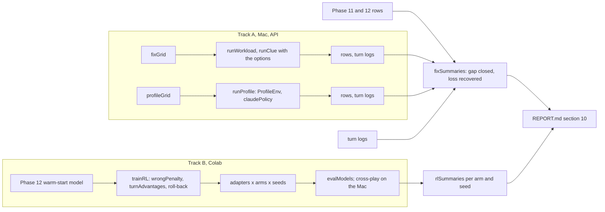

# High-level design: Phase 13, from diagnosis to fixes

## Components

| Module | New / changed | Contents |
|---|---|---|
| `nbs/clue_agents.ipynb` -> `explRL/clue_agents.py` | changed | `ClueBoard` keeps requests (`ask`, `requests`); `known(i, board, channel, checked=None)` drops clues the agent found false and pins those it found true |
| `nbs/clue_text.ipynb` -> `explRL/clue_text.py` | changed | `TextClueEnv(..., ask, table, record, check)`: schema per instance (`ask`, `check` in the action enum only with their options), rule sentences, observation lines, parsing of `ask` and `check`; `HINTS['evidence']`, `HINTS['warn']` |
| `nbs/clue_fix.ipynb` -> `explRL/clue_fix.py` | new (`clue_text` would pass 200 lines) | `fixOptions`, `fixSchema`, `FIX_RULES`, `trackRecord` (the `record` count; `clue_agents` is at 199 lines), `fixRules`, `fixBoard`, `fixLines`, `fixParse`, called by `TextClueEnv` |
| `nbs/clue_policy.ipynb` -> `explRL/clue_policy.py` | changed | `claudePolicy(client, workers=8, schema=CLUE_SCHEMA, task='clue')`: built with the environment's schema when `ask` or `check` is on, with the vote's for the vote; defaults unchanged |
| `nbs/clue_runs.ipynb`, `nbs/clue_train.ipynb`, `nbs/clue_roll.ipynb` | changed | the options pass from `cfg.world` (rows unchanged) |
| `nbs/hidden_profile.ipynb` -> `explRL/hidden_profile.py` | new | `profileTask`, `factTotals`, `ProfileEnv` (with `endRound`), `POST_SCHEMA`, `voteSchema`, `parseVote`, `soloCeiling` (the hidden-profile vote) |
| `nbs/profile_domains.ipynb` -> `explRL/profile_domains.py` | new (data only, split for size) | `DOMAINS`: names, fact templates and the rule-out sentence of the three domains |
| `nbs/profile_runs.ipynb` -> `explRL/profile_runs.py` | new | `ARMS`, `profileCell`, `runProfile` (batched episodes through `claudePolicy`), rows and turn logs |
| `nbs/fix_grid.ipynb` -> `explRL/fix_grid.py` | new | `FIX_ARMS`, `fixCell`, `fixGrid`, `profileGrid`, their pilots and quick grids, `FIX_PLAN`; `phase11Cells`, `requestKey`, `cellCalls`, `fixEstimate` (calls and cost, Phase 11's cached cells free) |
| `nbs/coop_grid.ipynb` -> `explRL/coop_grid.py` | changed | `RL13_ARMS`, `RL13_RUNS`, `RL13_PLAN`, `rl13Name`, `rl13Config`, `rl13Suite` beside `RL_PLAN` (Track B does not wait for Track A's code) |
| `nbs/fix_report.ipynb` -> `explRL/fix_report.py` | new | `fixLogMetrics` (asks, checks, checked-false from turn logs), `fixSummaries` (gap closed, loss recovered, costs, mechanism), `writeFix`, `figFix` |
| `nbs/fix_stats.ipynb` -> `explRL/fix_stats.py` | new (split from `fix_report` for size) | `gapClosed`, `lossRecovered` (bootstrap over the pairing units), `holmFamily` |
| `nbs/llm_fake.ipynb` -> `explRL/llm_fake.py` | changed | `fakeReply` sometimes asks or checks, only when the schema has those actions (Phase 10-12 fake runs unchanged) |
| `nbs/rl_adv.ipynb` -> `explRL/rl_adv.py` | new (split from `clue_rl` for size; pure numpy) | `trainingReturns`, `groupAdvantages`, `stepSamples` (moved), `wrongTimes`, `turnRewards`, `rewardsToGo`, `turnAdvantages` |
| `nbs/clue_rl.ipynb`, `nbs/rl_control.ipynb`, `nbs/rl_torch.ipynb` | changed | `advantage`, `wrongPenalty`, `haltJump` in `RLConfig`, `runFields`; `invalidShare`, `jumpGuard` (roll-back on a jump, in `rl_control`); `configHash` unchanged for Phase 12 configurations |
| `nbs/rl_report.ipynb` | changed | `armSeed`, `renameModel`, `bestArm`; per-arm means over training seeds, per-seed RL gains |
| `nbs/demo_fix.ipynb` | new | Track A: quick (fake client), pilots and main (`llm`) |
| `nbs/colab_clue_rl.ipynb`, `nbs/demo_rl.ipynb` | changed | Track B: `ARM`, `SEED`, `runs_p13/`; evaluation of the new adapters |
| `nbs/demo_multiagent.ipynb` | changed | section 10 of `REPORT.md` (Phase 13) |
| `nbs/sidebar.yml`, `nbs/index.ipynb`, `README.md` | changed | the new notebooks and links |

Import rule: as Phase 12; `hidden_profile` imports only `numpy` (named so as not to shadow the standard `profile`); `profile_runs` imports `hidden_profile`, `clue_policy` (`claudePolicy` with a schema, `parseReply`), `llm_runs` (`cellRow`, `llmStats`), `bench_grid`; `fix_grid` imports `clue_grid`, `llm_grid`, `llm_budget`; `coop_grid` as Phase 12; `fix_report` imports `llm_report`, `llm_figures`, `fix_stats` (which imports `bench_stats`, `llm_report`), `bench_grid`; `fix_grid` also imports `profile_runs` (`profileCell`) and `llm_runs` (`LLMConfig`). No module imports a demo; only `llm_client` imports `anthropic`.

## Data flow

## Main decisions

**K13-1. Gaps, not raw effects.** Each fix is reported as the share of a gap closed against an explicit ceiling (pooled bound, clean board, solo agent), computed from mean paired differences (a per-seed ratio would be unstable), so results across failures and against the red team's numbers read on one scale.

**K13-2. Affordance against instruction, every time.** Each part has a prompt-only control (`evidence`, `warn`, `dissent`). Phases 10-12 found wording did little; the claim to make is that mechanisms beat wording, so each test pairs them.

**K13-3. New actions are waits on the board.** `ask` and `check` change what agents know, not the board: the board's scoring, logs and welfare stay exactly as Phase 11, so every row compares with the saved ones, and the cost of an action is the turn it takes.

**K13-4. The checker's knowledge is private.** A check updates only the checker's known clues; spreading the result is the agent's choice (it can share the true clue). `record` is public and computed by the harness from solved subtasks only, so it is never wrong and needs no agent to report.

**K13-5. Their paradigm, small and checkable.** The vote reproduces the hidden-profile set-up the red team reports, with facts the harness publishes verbatim (no misquoting) and a solo ceiling measured with the same model, so "gap closed" has a measured top.

**K13-6. Track B fixes what Phase 12 diagnosed, one change per arm.** `indpen` changes only the loophole against Phase 12's individual run (a mechanism test); `credturn` adds turn-level credit on top of the loophole fix (the attempt to beat imitation); `credit` gives Phase 12 a second seed and is identical to it but for the seed. The roll-back guard (K13-8) is on in the two new arms; it acts only on a jump, so it changes nothing in a run without one. The penalty lives in the training reward only, so evaluation compares with every earlier row.

**K13-7. Turn-level baselines within the group.** The group already replays one board G times; comparing reward-to-go at the same slot and turn index across those replays gives a per-turn baseline without a value model (no extra parameters, same memory).

**K13-8. Roll back instead of only halting.** Phase 12's team run degraded in one step that its probe could not see. Keeping the previous update's weights and optimizer state until the next rollouts are checked turns that into a recoverable event.

## Risks

| Risk | Effect | Mitigation |
|---|---|---|
| `clue_text` grows past 200 lines | Rule broken | The options' lines and parsing move to `clue_fix` |
| A new action is used wrongly (asks every turn, checks own clues) | Arm measures misuse | Pilot invalid and use rates; the rule sentence says when each helps; misuse reported as mechanism |
| The vote's gap is too small or too large for Haiku | Gap closed undefined or at the floor | Pilot: baseline win rate between 0.2 and 0.8, adjust fact counts before freezing |
| Turn-level advantages are noisier at late turns (few rewards left) | Unstable training | Zero where the group's values are equal; the KL controller and roll-back as guards |
| Changes in `RLConfig` move Phase 12 hashes | Phase 12 resume and identity broken | `configHash` leaves out the new fields at their defaults; tested |
| Track A and B compete for attention | Delays | Track A on the Mac while Track B runs on Colab |
