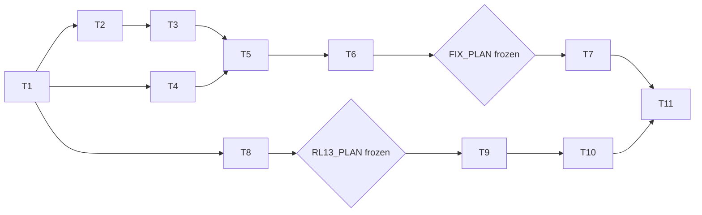

# Tasks: Phase 13, from diagnosis to fixes

Status (2026-10-15): T1-T4 and T8 done, and the evaluation code of T10 (code and tests; full suite, tiny-model tests and the Phase 11-12 cached reruns pass). `RL13_PLAN` frozen at `962c4e1` (hash `3e50a4002c7b`; gate B). T5 done (pilot $0.65, AC-6 passes); T6 done (`FIX_PLAN` frozen at `f01ad81`, hash `79abfb531cdd`). T7 done (Track A main runs $9.08, cached rerun identical; results in the README). Numpy forecast of the Track B arms frozen (`eb7b7c6` plan, `734839b` predictions; [forecast.md](forecast.md)). T9-T10 done (five runs, 13.9 GPU hours of training; evaluation and cross-play, $0.31; H13-4 and H13-5 supported; findings in the README); forecast scored (retrodiction 7/12, forecast 4/8). T11 done (`REPORT.md` section 10, with a revision note in section 9; README, RUN and plan status). All tasks done.

Rules for every task (as Phase 12):

- **Workflow:** code and tests in the notebook, then `nbdev-export` and `nbdev-test --n-workers 0` (one notebook per call when naming notebooks; `.venv/bin` first on `PATH`). After `nbdev-export`, restore modules whose only change is the cell-id comments.
- **Done means no regressions:** a task is done only when its tests pass and all earlier tests still pass, including the Phase 5-9 baselines and the Phase 10, follow-up, Phase 11 and Phase 12 reference outputs (cached reruns byte-identical; Phase 12 RL hashes unchanged).
- **Size:** each exported file under 200 lines; split rather than compress.
- **References:** section numbers refer to [design-low-level.md](design-low-level.md).
- **Offline tests:** normal tests never call the API or load a model, and run without `anthropic` and `torch`; API runs behind `llm`, model runs behind `train` and `gpu`.
- **Gates:**
  - no Track A main run before `FIX_PLAN` is frozen and committed (after both pilots);
  - no Track B run before `RL13_PLAN` is frozen and committed;
  - API spend under the $150 API cap ($47.22 spent); GPU spend under the $150 GPU cap ($27 spent).

## Order

Track A (T2-T7, Mac) and Track B (T8-T10, Colab) proceed side by side (P13-5).

## T1. References
- **What**: record the reference hashes of the Phase 12 outputs (`rl/eval/runs.csv`, turn logs, `config.json` hashes of the v2 runs) next to the Phase 11 ones.
- **Done when**: the hashes are written in the README; the full suite passes.

## T2. Clue-board options
- **Files**: `nbs/clue_agents.ipynb`, `nbs/clue_text.ipynb` (and `nbs/clue_fix.ipynb` if needed), `nbs/clue_runs.ipynb`, `nbs/clue_train.ipynb`, `nbs/clue_roll.ipynb` (section 1).
- **What**: `ask`, `table`, `record`, `check`; the schema per environment and `claudePolicy`'s schema argument (`nbs/clue_policy.ipynb`); `known(..., checked)`; the two hints; the options from `cfg.world` (rows unchanged).
- **Tests**: **AC-2**; rollout rows still equal `runClue` rows with each option on (scripted replies); Phase 11 and 12 cached reruns byte-identical.

## T3. Track A grid, report and quick demo
- **Files**: new `nbs/fix_grid.ipynb` (section 3), new `nbs/fix_report.ipynb` (section 5, with `fixLogMetrics`), new `nbs/demo_fix.ipynb` (section 6).
- **Tests**: **AC-5**; `fixLogMetrics` on hand-made logs (AC-2); grid sizes and call estimates; the quick demo writes every artifact with the fake client in under 30 s, identical at 1 and 8 processes.

## T4. The hidden-profile vote
- **Files**: new `nbs/hidden_profile.ipynb`, new `nbs/profile_runs.ipynb` (section 2).
- **Tests**: **AC-3**; rows and turn logs from the fake client; a cached rerun identical.

## T5. Pilots (live, under $1)
- **What**: re-check prices; run `fixPilotGrid` and `profilePilotGrid` live. Check invalid replies under 5% for `ask`, `check` and the vote; the vote's baseline win rate between 0.2 and 0.8 and the solo ceiling at least 0.8. If the win rate is outside the band, change `shared` and `unique` (section 2) and rerun the pilot once; if still outside, stop and ask.
- **Done when**: **AC-6** (pilot part); findings in the README.

## T6. Freeze `FIX_PLAN`
- **What**: set the pilot-informed settings, freeze, commit; record the commit and `coopHash(FIX_PLAN)` in the README (gate A).

## T7. Track A main runs (live, about $10-15)
- **What**: `fixGrid` and `profileGrid` through `runWorkload` and `runProfile`; the report; a cached rerun. If the budget allows, the Sonnet 5.5 check of the best arm per part (P13-2), labelled extra.
- **Done when**: **AC-7**; findings in the README, labelled exploratory.

## T8. RL changes and `RL13_PLAN`
- **Files**: `nbs/clue_rl.ipynb`, `nbs/rl_control.ipynb`, `nbs/rl_torch.ipynb` (section 4); `nbs/coop_grid.ipynb` (`RL13_PLAN`, section 3); `nbs/colab_clue_rl.ipynb` (Phase 13 section); `nbs/rl_report.ipynb` (per arm and seed).
- **Tests**: **AC-4** offline; `train` flag: two RL steps on the tiny model with `advantage='turn'` and `wrongPenalty`, a forced jump rolled back, resume. Freeze `RL13_PLAN`, commit, push (gate B).

## T9. Track B runs (Colab, five sessions)
- **What**: one session per run (`ARM`, `SEED`; restart first): `credit` seed 2, `indpen` seeds 1-2, `credturn` seeds 1-2; GPU hours per run in the README; pack and download after the last.
- **Done when**: five runs finished or halted by a rule, reported.

## T10. Track B evaluation
- **What**: Colab evaluation of the five adapters without cross-play (`evalModels`); cross-play for both seeds of the best arm on the Mac (`RL13_PLAN`'s rule); the report per arm and seed; a cached rerun.
- **Done when**: **AC-8**; findings in the README, labelled exploratory.

## T11. Docs
- **What**: README results and a plain-language figure guide; `RUN.md`; `REPORT.md` section 10 from `demo_multiagent`; the multi-agent plan's status and conclusions; links from `nbs/index.ipynb`, `README.md` and the sidebar.
- **Done when**: docs updated; all checks pass.

## T12. HiddenBench replication (added 2026-10-16; done)
- **Files**: `data/hiddenbench/` (vendored, MIT), new `nbs/hidden_bench.ipynb`, `nbs/profile_runs.ipynb` (dispatch), `nbs/fix_grid.ipynb` (`HB_PLAN`, grids), new `nbs/demo_hb.ipynb`; plan and results in [hiddenbench.md](hiddenbench.md).
- **Done**: AC-3b; pilot passed and `HB_PLAN` frozen (`a75f11f`); main run $3.46, cached rerun identical; results in the README, the preprint and `REPORT.md`.

## Acceptance criteria to task map

| AC | Task |
|----|------|
| AC-1 | T1, T2, T8, T11 |
| AC-2 | T2 |
| AC-3 | T4 |
| AC-3b | T12 |
| AC-4 | T8 |
| AC-5 | T3 |
| AC-6 | T5, T6 |
| AC-7 | T7 |
| AC-8 | T9, T10 |
