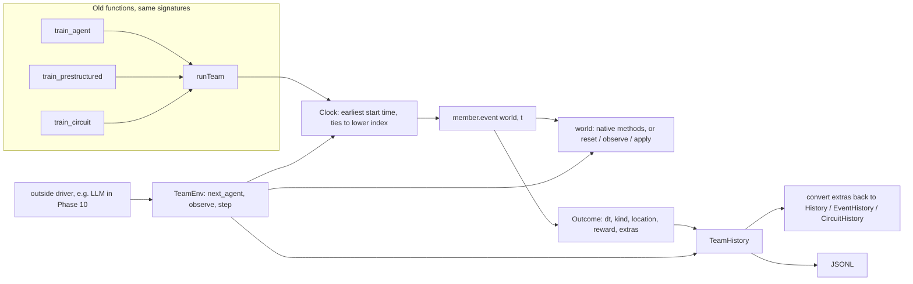

# High-level design: Phase 5, shared multi-agent interface

## Components

| Module | New / changed | Contents |
|---|---|---|
| `nbs/multi.ipynb` -> `explRL/multi.py` | new | `Record`, `Outcome`, `TeamHistory` (with JSONL export), `spawnRngs`, `Member` (base class with the default `event`), `Clock` (event queue), `runTeam`, `TeamEnv` |
| `nbs/members.ipynb` -> `explRL/members.py` | new | `FlexibleMember`, `PrestructuredMember`, `CircuitMember` |
| `nbs/train.ipynb` -> `explRL/train.py` | changed | `train_agent` becomes a wrapper over `runTeam` |
| `nbs/prestructured_train.ipynb` -> `explRL/prestructured_train.py` | changed | `train_prestructured` becomes a wrapper |
| `nbs/circuit_train.ipynb` -> `explRL/circuit_train.py` | changed | `train_circuit` becomes a wrapper (keeps `t0`) |
| `nbs/demo_multi.ipynb` | new | four circuit agents in one symmetric `ZoneArena`: event timeline, per-agent learning curves (PI, goal distance, jump rate), JSONL export, independence check; quick (300 s) and slow (1200 s) artifacts under `results/multiagent/demo_multi/{quick,full}/` |
| `nbs/fixtures/phase5/*.npz`, `tools/make_phase5_fixtures.py` | new | golden histories saved from the old code (committed), and the script that made them |
| `tools/phase5_demo_hashes.sh` | new | runs the three demos quick and slow for a given checkout; writes the six `metrics.json` copies, `sha256.txt` and slow wall times (used on the old commit for the baseline and on the new code for the check) |
| `.gitignore` | changed | adds `results/multiagent/` |

Models (`agents`, `prestructured`, `circuit`, `circuit_agent`), worlds (`envs`), loaders (`core`) and the run helpers (`runMany`, `runManyPrestructured`, `circuit_runs`) do not change.

## Data flow

## Main decisions

**D1. Event queue (plan Q1).** A heap holds `(next start time, agent index)` for each member. The loop pops the earliest, runs one event if its start time is below the end time, and pushes it back with `t + dt`. With one member this is the old `while t < tEnd: ...; t += dt` loop, step for step. A fixed time step would change the event-based agents' behaviour.

**D2. One `event(world, t)` method per member (P1).** The existing agents cannot be split into "act, then learn" without changing their results: the circuit agent updates compass weights at each grid step *inside* a saccade, and the jump draw right after uses those new weights; the flexible and pre-structured agents learn between the world step and the next draw. So each adapter's `event` is the body of its old loop, moved over unchanged. New agents for generic worlds (Phase 6+) only write `act` and `learn`; the base class's default `event` calls observe, `act`, `apply` and `learn` in that order. This is the "template method" pattern: one loop, one method to call, and the strict split where it fits.

**D3. Native time units (P2).** `runTeam` never converts time. The flexible agent stays in integer samples (its old loop counts `t` in samples up to `round(Ttot / delT)`); converting to float seconds would change float sums and could change the event count, breaking exactness. Each member declares `timeUnit`, and a team must share one. Mixed teams are out of scope; Phase 6 agents use seconds.

**D4. Old rows kept verbatim (FR-8, FR-13).** Each adapter returns the old loop's per-event row (minus time) as `extras`, built by the same expressions. The wrappers rebuild the old history classes from `(t,) + extras`, using the same constructors as now. The unified fields (`kind`, `location`, `reward`) are added next to the row; they do not replace it.

**D5. Ties to the lower index (P3).** Heap entries are tuples `(t, index)`, so equal start times pop in index order. This makes multi-agent runs deterministic, which matters from Phase 6 on, when two agents arriving at one patch at the same time split it.

**D6. No PettingZoo dependency (P6).** `TeamEnv` copies the agent-environment-cycle idea and names (`reset`, `next_agent`, `observe`, `step`), which is enough for outside drivers and keeps the dependency list unchanged.

**D7. Native worlds untouched; a small protocol for new worlds.** Adapters call `HeadingArena.step`, `ZoneArena.ringActivity` and `ZoneArena.valence` directly, as the old loops do. New worlds implement `reset(seed, nAgents)`, `observe(i)` and `apply(i, action) -> (reward, dt, location, info)`; in this phase only a toy test world does. A generic world owns the agents' locations (needed for crowding later); native agents keep owning their headings.

**D8. Two regression checks (P4), both taken from the old commit.** (1) Golden fixtures: a script saves short seeded runs of all three old functions to `.npz` (every field); tests compare them exactly. These stay as permanent regression tests. (2) Hashes: the SHA-256 of all six demo `metrics.json` files and the slow demo wall times (in `results/multiagent/baseline_phase5/`). Both are produced by running the pre-Phase-5 commit in a separate git worktree, so they cannot be overwritten by output of the new code and can be rebuilt at any time.

**D9. `Clock` shared by `runTeam` and `TeamEnv`.** Both use the same small event-queue class, so the "who goes next" rule exists in one place and FR-11 (identical histories) holds by construction.

## Rejected alternatives

| Alternative | Why not |
|---|---|
| Fixed time step for all agents | Changes event-based behaviour; breaks exactness |
| Strict `act` / `learn` for the existing agents | Reorders the circuit agent's mid-saccade learning and the draws after it |
| Convert all time to seconds | Changes float sums for the flexible agent (up to 240 000 additions of 0.001 per run) and possibly the event count |
| Keep the old loops and add a separate multi-agent loop | Two loops drift apart; Phase 6+ results would not be comparable with the demos |
| Use the PettingZoo package | New dependency; its parallel API does not fit event-based agents, and its AEC API is easy to mirror |

## Risks

| Risk | Effect | Mitigation |
|---|---|---|
| Slower flexible demo (20 runs of up to 240 000 events, each event now with a heap push/pop, a record and a method call) | NFR-2 fails | Measured: the full flexible demo is 4.6% slower (39.5 s to 41.3 s); a one-member plain loop would save only about 2%, so it was not added |
| A float result changes because an expression is regrouped (for example `t + (fix + tS)` vs `(t + fix) + tS`) | Exactness fails | Adapters return `dt` built by the same expression as the old loop; the loop only does `t + dt`; golden fixtures catch any drift |
| Memory: up to 240 000 records per flexible run | Higher peak memory in `runMany` | Records are small named tuples (about 300 bytes each, so about 72 MB per run), freed after each run (as `del hist` does now); T6 checks the peak stays under about 200 MB |
| Import cycle (`train` -> `members` -> models) | Import error | `members` imports only model modules (NFR-5) |
| Golden fixtures or baseline hashes regenerated by mistake from new code | Regression test becomes meaningless (this happened once to the first baseline copy) | Both are made from a worktree of the old commit; fixtures are committed and the script refuses to overwrite; the baseline lives in its own folder that only the old-commit run writes |
