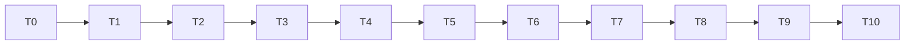

# Tasks: Phase 5, shared multi-agent interface

Status: T0–T10 done (2026-10-11). The first T0 baseline copy was overwritten by output of the new code during T6-T8; it was rebuilt from a git worktree of the pre-Phase-5 commit `905a48d` (see T0), and the fixtures were regenerated the same way with every field saved. All checks below were re-run against that rebuilt baseline.

Rules for every task:

- Write code and tests in the notebook, then run `nbdev-export` and `nbdev-test --n-workers 0` (with `.venv/bin` first on `PATH`).
- A task is done only when its tests pass and all earlier tests, including the three existing demos, still pass.
- Keep each exported file under about 200 lines.
- Section numbers below refer to [design-low-level.md](design-low-level.md).
- **T0 and T1 must run on the unchanged code.** Do not edit any module before both are done.

## Order

T6-T8 switch one old function at a time, so a failure points to one adapter.

## T0. Record the baseline (unchanged code)
- **What**: add `results/multiagent/` to `.gitignore` (today it lists only the three `results/demo*` folders); then run `tools/phase5_demo_hashes.sh` on a worktree of the pre-Phase-5 commit, writing to `results/multiagent/baseline_phase5/` (section 10; commands in RUN.md).
- **Done when**: `git status` does not show `results/multiagent/`; `results/multiagent/baseline_phase5/` holds six files, `sha256.txt` and `timing.txt`; running the slow demos a second time gives the same hashes.

## T1. Golden fixtures (unchanged code)
- **Files**: new `tools/make_phase5_fixtures.py`; output `nbs/fixtures/phase5/*.npz`.
- **What**: the runs in section 9, run on the worktree of the pre-Phase-5 commit. The script saves every history field and refuses to overwrite existing files.
- **Done when**: the three `.npz` files exist and are committed; running the script again exits with a message and changes nothing.

## T2. Records, history, seeds
- **Files**: new `nbs/multi.ipynb` (exports `explRL/multi.py`).
- **What**: `Record`, `Outcome`, `TeamHistory` with `forAgent` and `toJSONL`, `spawnRngs` (section 1).
- **Tests**: **AC-6** (write a small history with numpy ints, floats and bools in `extras`, read the lines back, check keys and values); **AC-7**.

## T3. Clock, Member, runTeam
- **Files**: `nbs/multi.ipynb`.
- **What**: `Clock`, `Member` with the default `event`, `runTeam` (sections 2-4); the toy world and members for tests (section 8).
- **Tests**: **AC-3** (the eight-event order in section 8); **AC-4** for `runTeam` (empty team, mixed units, `dt <= 0`); `learn` is called once per event; a team of one toy member gives `t` values `t0, t0 + dt, ...`.

## T4. TeamEnv
- **Files**: `nbs/multi.ipynb`.
- **What**: `TeamEnv` (section 7).
- **Tests**: **AC-5** (`next_agent` sequence, `done` flags, final `None`, `RuntimeError` after the end, same seed same history, equal to `runTeam` with `ToyMember`s taking the same actions after `world.reset(seed, n)`).

## T5. Adapters
- **Files**: new `nbs/members.ipynb` (exports `explRL/members.py`).
- **What**: `FlexibleMember`, `PrestructuredMember`, `CircuitMember` (section 5).
- **Tests**: `timeUnit` and `extraNames` are as specified; mixing `FlexibleMember` with a seconds member raises `ValueError`; `members` does not import any training module (NFR-5). Exactness of each adapter is tested through its thin wrapper with the golden fixture (AC-1, T6-T8), so it is not duplicated here.

## T6. Switch `train_agent`
- **Files**: `nbs/train.ipynb`.
- **What**: the wrapper in section 6; update its docstring.
- **Tests**: **AC-1** for `flexible.npz`; existing `train` tests pass.
- **Check NFR-2**: time the slow flexible demo against `timing.txt`. If it is more than 25% slower, add the one-member fast path (section 3) with its test, and re-time. Also check that the peak memory of one 240 s flexible run stays under about 200 MB (estimate: about 300 bytes per record x up to 240 000 records = up to about 72 MB).
- **Outcome**: 4.6% slower (39.5 s to 41.3 s), so no fast path; peak memory 49.8 MB for a 240 s run (seed 0, 106 658 events).
- **Done when**: tests pass and both flexible `metrics.json` hashes (quick and full) equal the baseline.

## T7. Switch `train_prestructured`
- **Files**: `nbs/prestructured_train.ipynb`.
- **What**: the wrapper in section 6.
- **Tests**: **AC-1** for `prestructured.npz`; existing tests pass.
- **Done when**: tests pass and both pre-structured `metrics.json` hashes equal the baseline.

## T8. Switch `train_circuit`
- **Files**: `nbs/circuit_train.ipynb`.
- **What**: the wrapper in section 6 (keeps `t0`; `probe`, `concatHistory`, `endTime` unchanged).
- **Tests**: **AC-1** for `circuit.npz` (both segments and the probe); existing tests pass.
- **Done when**: tests pass and both circuit `metrics.json` hashes equal the baseline.

## T9. Independence and demo
- **Files**: `nbs/members.ipynb` (tests), new `nbs/demo_multi.ipynb`, `nbs/sidebar.yml`.
- **What**: **AC-2** tests (three circuit agents in one `ZoneArena`; three pre-structured agents in one `HeadingArena`); the demo in section 11; add `multi`, `members` and `demo_multi` to the sidebar.
- **Done when**: tests pass; the demo runs in normal tests and writes `team.jsonl`, `timeline.png`, `learning.png` and `metrics.json` (with `independent: true` and `learning_outcomes`) to `results/multiagent/demo_multi/quick/`; the slow cell writes the same under `full/`.

## T10. Final regression and docs
- **What**:
  - run the full suite and the three slow demos; check **AC-8** (all six hashes equal `sha256.txt`), **AC-9** (times against `timing.txt`) and **AC-10** (all tests pass; line counts of `multi.py` and `members.py`);
  - write `specs/multiagent/phase5/RUN.md` (same layout as the other RUN files);
  - set this spec's status to implemented, with the measured times; mark Phase 5 done in [../README.md](../README.md);
  - update the module docstrings of `train`, `prestructured_train` and `circuit_train` to say they run through `runTeam`;
  - link `nbs/demo_multi.ipynb` and `RUN.md` from `nbs/index.ipynb` (next to the three existing demos) and from the "Related" / "Related demos" section of the other three `RUN.md` files; run `nbdev-readme`.
- **Done when**: all checks pass and the docs are updated.

## Acceptance criteria to task map

| AC | Task |
|----|------|
| AC-1 | T6, T7, T8 |
| AC-2 | T9 |
| AC-3, AC-4 | T3 (AC-4 `TeamEnv` part in T4) |
| AC-5 | T4 |
| AC-6, AC-7 | T2 |
| AC-8, AC-9, AC-10 | T10 (AC-9 first checked in T6) |
