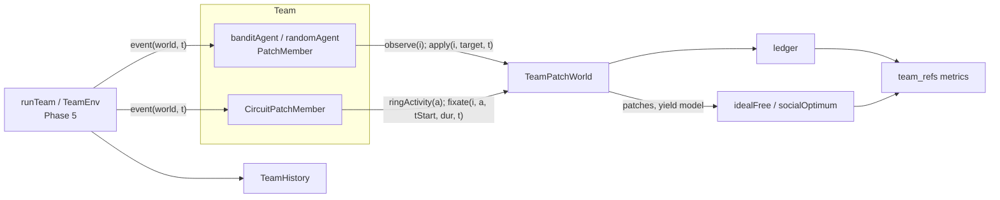

# High-level design: Phase 6, team environment with incentives

## Components

The plan named one module (`explRL/team.py`). It is split in three to keep each file under 200 lines.

| Module | New / changed | Contents |
|---|---|---|
| `nbs/patchworld.ipynb` -> `explRL/patchworld.py` | new | `Layout`, `ringLayout`, `torusLayout`, `TeamPatchWorld` (protocol, harvest, regrowth, moves, rewards, ledger, `neighbours`, ring methods, `zoneConfig`) |
| `nbs/team_agents.ipynb` -> `explRL/team_agents.py` | new | `PatchMember`, `randomAgent`, `banditAgent`, `CircuitPatchMember` |
| `nbs/team_refs.ipynb` -> `explRL/team_refs.py` | new | `yieldModel`, `idealFree`, `socialOptimum`, `ledgerArrays`, metrics (`welfare`, `gini`, `occupancy`, `coverage`, `dangerShare`, `ifdDistance`, `timeToIFD`, `welfareLoss`) |
| `nbs/multi.ipynb` -> `explRL/multi.py` | changed | `Member.event` and `TeamEnv.step` pass `t` to `world.apply` (S4); toy world updated; `Record.kind` comment lists `'stay'` / `'travel'` |
| `nbs/members.ipynb` -> `explRL/members.py` | changed | `CircuitMember.reward` hook (S6); valence read moved after the fixation draw |
| `nbs/demo_team.ipynb` | new | the demo in design-low-level section 9; writes `results/multiagent/demo_team/{quick,full}/` |
| `tools/phase6_prototype.py` | new (throwaway) | the T1 dynamic-range check; writes `results/multiagent/phase6_prototype/` |
| `nbs/sidebar.yml` | changed | adds `patchworld`, `team_agents`, `team_refs` and `demo_team` |

Import rule (as Phase 5 NFR-5): `team_refs` imports nothing from the package (it reads world attributes by name), so it can be imported by `patchworld` without a cycle. `patchworld` imports `multi` (`spawnRngs`), `circuit` (ring activity), `envs` (`ZoneArena` for `zoneConfig`) and `team_refs` (`yieldModel` for the team and difference rewards). `team_agents` imports `multi` and `members`. No module imports a training module.

## Data flow



## One generic event (stay or travel)

```mermaid
sequenceDiagram
  participant Q as runTeam
  participant A as banditAgent
  participant W as TeamPatchWorld
  Q->>A: event(world, t)
  A->>W: observe(i)
  A->>A: act(obs) -> target j
  A->>W: apply(i, j, t)
  W->>W: advance(t): regrow stocks, apply moves up to t
  alt j == location (stay)
    W->>W: register stay [t, t + tStay); n = 1 + others covering t; claim
  else travel
    W->>W: clear stay; location = j; dt = T[loc, j]
  end
  W-->>A: reward (scheme), dt, location, info
  A->>A: learn(obs, j, reward, info)
  A-->>Q: Outcome(dt, kind, location, reward, extras)
```

## Main decisions

**D1. Claim at the start of a stay (S3).** The Phase 5 loop needs the reward when `apply` returns, but who else arrives during a stay is not known yet. Instead of approximating a continuous split, the model *is* discrete: a claim splits what the patch offers among the agents present at that instant (their stay intervals cover `t`), including the claimant. Over many short stays this approaches equal sharing. Rejected: paying rewards one event late (the PettingZoo way), because it breaks the Phase 5 meaning of a record's reward and drops the last event's reward.

**D2. Lazy world time (S4).** The world advances its stocks and patch moves to `t` on each call. `runTeam` processes events in start-time order, so `t` never goes back; the world checks this. Passing `t` is a one-line change in `Member.event` and `TeamEnv.step`; the paper adapters do not call `apply`, so Phase 5 results cannot change. Rejected: the world keeping its own copy of each agent's clock (duplicates `Clock` and breaks with `t0 != 0`).

**D3. Two patch models (S2).** *Fixed intake* is the textbook IFD case: input matching, and IFD equals SO in welfare. *Logistic stock* can be over-harvested: above `g K / 4` the stock collapses, so selfish crowding (IFD) loses welfare against the SO. The gap is what reward schemes and, later, communication can fix. The prototype picks the default: both models passed T1, and fixed intake passed most clearly on the ring, so it is the default.

**D4. Shaped rewards from the yield model (S5).** Team and difference rewards need "the team's harvest" and "the harvest without me", which a discrete-event world cannot compute exactly without simulating counterfactuals. Both are computed from `E_p(n)` at the current occupancy, the same model the references use, so rewards, references and metrics agree. The individual reward is the actual claim.

**D5. The circuit agent through a hook (S6).** `CircuitMember` reads the valence before the fixation draw, but no random draw depends on it, so moving the read after the draw changes nothing (checked by the golden fixtures). The new `reward(world, t, fix)` hook lets `CircuitPatchMember` claim the fixation interval `[t + tS, t + tS + fix)` and turn the harvest into the `+1 / -1 / 0` signal its goal learning uses. In `zoneConfig` this gives exactly the `ZoneArena` valence (AC-1).

**D6. Locations, not directions, for generic agents.** Generic agents choose a target location and are charged the travel time (they see nothing on the way). The circuit agent keeps its native saccades; on the ring its heading is its location. This is why the circuit agent cannot go to the torus.

**D7. One world generator, separate streams.** The world draws patch sites, danger sites, moves and observation noise from its own generators (`spawnRngs(seed, 3)`); agents get theirs from `spawnRngs(seed', n)`. Adding an agent does not change the world's draws.

## Risks

| Risk | Effect | Mitigation |
|---|---|---|
| The world is too easy or too hard (harnesses look alike) | Phases 7-8 show nothing | T1 prototype with the dynamic-range check before any package code; difficulty settings in one place |
| Claim-at-start favours the first agent to arrive | Biased crowding cost | Short `tStay` (1 s) relative to patch time scales; the Gini of agents' harvest is reported; noted in the design |
| Logistic collapse is abrupt (`E_p(n)` jumps down) | IFD and metrics jumpy | Both patch models available; the floor `Smin` keeps patches alive; prototype checks the default |
| Logistic defaults where `g K / 4 < c` | One agent collapses every patch; both references trivial | Defaults keep `g K / 4` well above `c` (5 vs 1); stated next to the defaults |
| The synchronous prototype does not transfer to the event-based world | Wrong layout or defaults chosen | The demo's full run re-runs prototype checks (1) and (2) on the package world (AC-12) |
| Shaped rewards differ from realised harvest under logistic stocks | Agents optimise a model, not the world | Welfare always uses the realised harvest; the difference is reported |
| Circuit hook breaks Phase 5 exactness | Regression | Golden fixtures and the six demo hashes re-run in T2 |
| 64 agents too slow | Slow tests | Vectorised `banditAgent` scores; NFR-2 timing in T8 (measured about 4 s for 64 agents, 600 s, so claims can keep scanning all stays) |
