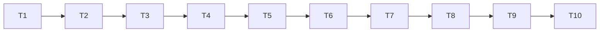

# Tasks: Phase 6, team environment with incentives

Status: all tasks done (2026-10-11). T1: passes with the defaults for all four (layout, model) pairs; main = ring, fixed intake. T8: 64 `banditAgent`s, ring, 600 s, about 4 s. T9: full demo about 1 minute, package-world checks (1) and (2) pass. Measured results are in [README.md](README.md).

Rules for every task:

- Write code and tests in the notebook, then run `nbdev-export` and `nbdev-test --n-workers 0` (one notebook per call when naming notebooks; `.venv/bin` first on `PATH`).
- A task is done only when its tests pass and all earlier tests, including the Phase 5 golden fixtures and the three paper demos, still pass.
- Keep each exported file under about 200 lines.
- Section numbers below refer to [design-low-level.md](design-low-level.md).
- **T1 is a gate.** No package code (T2 on) before T1 passes and S1, S2 and the *(T1)* defaults are filled in.

## Order

## T1. Prototype and dynamic-range check (gate)
- **Files**: new `tools/phase6_prototype.py`; output `results/multiagent/phase6_prototype/` (gitignored).
- **What**: section 10.
- **Done when**: **AC-11** passes for at least one (layout, model); `report.md` lists every attempt; S1, S2 and the *(T1)* defaults in this spec are updated. If nothing passes after a few rounds of difficulty changes, stop and review the plan with the user before going on.

## T2. Phase 5 amendments
- **Files**: `nbs/multi.ipynb`, `nbs/members.ipynb`.
- **What**: section 1 (`apply(..., t)`; `CircuitMember.reward` hook; `Record.kind` comment). Phase 5 FR-9 already notes this planned change.
- **Tests**: **AC-2** (golden fixtures, Phase 5 toy-world and `TeamEnv` tests); the default hook returns `world.valence(a)`.
- **Done when**: tests pass and the six paper-demo `metrics.json` hashes still equal `results/multiagent/baseline_phase5/sha256.txt`.

## T3. Layouts
- **Files**: new `nbs/patchworld.ipynb` (exports `explRL/patchworld.py`).
- **What**: `Layout`, `ringLayout`, `torusLayout` (section 2).
- **Tests**: **AC-3** (except `neighbours`, done in T5).

## T4. World core
- **Files**: `nbs/patchworld.ipynb`.
- **What**: `TeamPatchWorld` constructor, `reset`, `advance`, `_regrow`, `_move`, `_claim`, `patchAt`, `apply` with the individual scheme, ledger (sections 3, 3.1-3.3).
- **Tests**: **AC-4**; **AC-5**; travel moves the agent and lasts `T[loc, j]`; stay lasts `tStay`; the ledger has one row per call.

## T5. Rewards, observations and ring methods
- **Files**: `nbs/patchworld.ipynb`; new `nbs/team_refs.ipynb` (exports `explRL/team_refs.py`, `yieldModel` only for now).
- **What**: team and difference schemes, noise, `observe`, `neighbours`, `ringActivity`, `valence`, `fixate`, `zoneConfig` (sections 3.3-3.5). The team and difference schemes need `yieldModel`: put it in `team_refs` (T7) now, with its tests.
- **Tests**: **AC-6**; `neighbours` part of **AC-3**; `zoneConfig` safe and danger sites equal `ZoneArena.isSafe` for both scenes.

## T6. Agents and the sanity bridge
- **Files**: new `nbs/team_agents.ipynb` (exports `explRL/team_agents.py`).
- **What**: `PatchMember`, `randomAgent`, `banditAgent`, `CircuitPatchMember` (section 4).
- **Tests**: **AC-1** (both scenes, seeds 0-2, 300 s); **AC-8**; **AC-10** (same seeds give identical histories and ledgers; `toJSONL` with the new extras; `TeamEnv` replaying the same actions gives the same ledger).

## T7. References and metrics
- **Files**: `nbs/team_refs.ipynb` (created in T5).
- **What**: `idealFree`, `socialOptimum`, `ledgerArrays` and the metrics (sections 5, 6).
- **Tests**: **AC-7** (worked check in section 5, random small worlds against brute force, logistic gap); **AC-9**.

## T8. Speed
- **What**: time a 64-agent `banditAgent` team, 600 s, `MAIN` layout (NFR-2); apply the section 8 fix if needed.
- **Done when**: under 30 s, with the measured time recorded here.

## T9. Demo
- **Files**: new `nbs/demo_team.ipynb`; `nbs/sidebar.yml` (add `patchworld`, `team_agents`, `team_refs`, `demo_team`).
- **What**: section 9.
- **Done when**: **AC-12**: quick run in normal tests (under 10 s), full run with `--flags slow`, both writing their artifacts and `metrics.json`; the full run's re-run of prototype checks (1) and (2) is recorded (if either fails, note it in the README and revisit the defaults before Phase 7).

## T10. Final regression and docs
- **What**:
  - run the full suite and the three paper slow demos; check **AC-13** (six hashes unchanged, all tests pass, line counts, no new dependencies);
  - write `specs/multiagent/phase6/RUN.md` (same layout as the other RUN files);
  - set this spec's status to implemented with the measured results (prototype outcome, references, team-run findings, timings); mark Phase 6 done in [../README.md](../README.md);
  - link `nbs/demo_team.ipynb` and `RUN.md` from `nbs/index.ipynb` and the other `RUN.md` files; run `nbdev-readme`.
- **Done when**: all checks pass and the docs are updated.

## Acceptance criteria to task map

| AC | Task |
|----|------|
| AC-1 | T6 |
| AC-2 | T2 |
| AC-3 | T3 (`neighbours` in T5) |
| AC-4, AC-5 | T4 |
| AC-6 | T5 |
| AC-7, AC-9 | T7 |
| AC-8, AC-10 | T6 |
| AC-11 | T1 |
| AC-12 | T9 |
| AC-13 | T10 |
