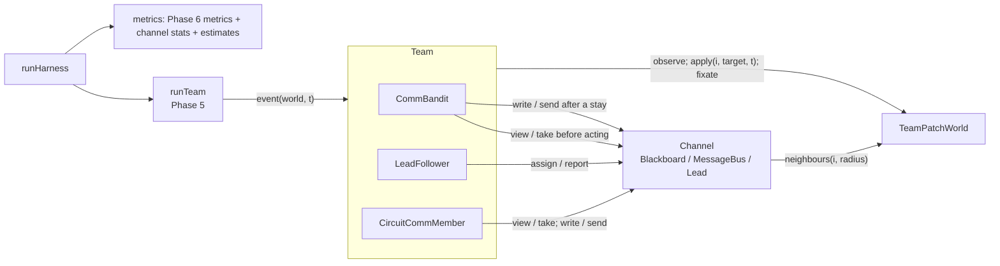

# High-level design: Phase 7, harness configurations

## Components

The plan named one module (`explRL/harness.py`). It is split in three to keep each file under 200 lines.

| Module | New / changed | Contents |
|---|---|---|
| `nbs/harness.ipynb` -> `explRL/harness.py` | new | `Blackboard`, `MessageBus`, `Lead` (channels, with per-agent `stats`) |
| `nbs/harness_agents.ipynb` -> `explRL/harness_agents.py` | new | `CommBandit`, `LeadFollower`, `CircuitCommMember` |
| `nbs/harness_runs.ipynb` -> `explRL/harness_runs.py` | new | `HarnessConfig`, `benchWorld`, `circuitWorld`, `worldTime`, `makeChannel`, `makeTeam`, `runHarness`, `harnessMetrics`, `rangeCheck` |
| `nbs/team_agents.ipynb` -> `explRL/team_agents.py` | changed | `banditAgent._stats()` helper, used by `act`; `CircuitPatchMember.reward` keeps its net harvest (no behaviour change) |
| `nbs/patchworld.ipynb` -> `explRL/patchworld.py` | changed | `fixate` sets `loc[i] = a` (no change to rewards, ledger or draws) |
| `nbs/demo_harness.ipynb` | new | the demo in design-low-level section 8; writes `results/multiagent/demo_harness/{quick,full}/` |
| `tools/phase6_demo_hashes.sh` | new | hashes the Phase 6 `demo_team` `metrics.json` files, for NFR-1 |
| `nbs/sidebar.yml` | changed | adds `harness`, `harness_agents`, `harness_runs`, `demo_harness` |

Import rule (as Phases 5 and 6): `harness` imports only numpy (channels read the world through `neighbours` passed in by the caller). `harness_agents` imports `harness`, `team_agents`, `members` (indirectly through `team_agents`) and `circuit` (`goalStep`). `harness_runs` imports `harness`, `harness_agents`, `patchworld`, `team_agents`, `team_refs`, `multi`, `core` (`loadCircuitAgent`) and `circuit` (`goalStats`). No module imports a training module or a demo.

## Data flow



## One `CommBandit` event

```mermaid
sequenceDiagram
  participant Q as runTeam
  participant A as CommBandit
  participant C as Channel
  participant W as TeamPatchWorld
  Q->>A: event(world, t)
  A->>C: take(i) (messages) / view(i, t) (blackboard)
  A->>A: estimate per location from own stays + w x reports
  A->>W: observe(i); apply(i, j, t)
  W-->>A: reward, dt, location, info
  A->>A: learn (own stay window)
  alt stay
    A->>C: write(i, loc, rate, t) / if due: send(world, i, best, value, t)
  end
  A-->>Q: Outcome
```

## Main decisions

**D1. The channel is outside the world (H1).** Communication is a property of the team, not of the patches. Keeping it in a separate object means the world, its generators and its ledger are untouched, so Phase 6 results cannot move, and the same world can be run with any channel. Rejected: a world wrapper that adds channel state to observations (it would change the world protocol and mix concerns that Phase 9 needs separate, such as who wrote what).

**D2. Reports are weighted extra observations (H2, plan Q8).** A report says "location `j` paid `v` per second". The simplest consistent use is to add it to the same mean the agent already keeps, with a weight `w`. This gives one knob for how much agents trust others, a clean limit (`w = 0` is Phase 6 exactly, which is the bridge test) and an obvious place for Phase 9 trust weighting (a per-sender `w`). The blackboard is read as a view at act time and the agent's own entries are excluded, so repeated reads and its own writes are never counted twice. Rejected: copying board entries into agent memory (double counting on every read), or treating reports as a separate prior (two knobs where one is enough).

**D3. Agents share only what they experienced (H3).** Writing and sending only first-hand experience prevents an "echo chamber" where one report is relayed back and forth and looks like many. It also makes Phase 9's liar a clean deviation from honest behaviour. The cost: information spreads one hop per message period, which is a property of the `messages` channel, not a flaw.

**D4. Fading by age (H4), stored two ways.** Exponential fading makes `lam` a direct "half-life" setting (`ln 2 / lam`), and because every entry fades at the same rate, faded sums can be kept as running totals. With full memory (`K = None`, the default) the blackboard keeps running faded sums, plus one copy per writer so a reader's own entries can be left out; a read then costs the same however long the run. With a window `K` it keeps a ring buffer per location, because running sums cannot drop old entries. Both give the same view (checked in AC-3). Rejected: one growing buffer for full memory (a busy patch in a 64-agent, 600 s run collects about 12 000 entries, which would make every read slow).

**D5. Per-agent message periods and seeded recipients (H6).** The world is event-based, so there is no global "every 10 s" tick. Each agent checks at its own events whether a new period has started. Recipients come from the agent's own message generator, separate from its other draws and from the world's, so turning messages on does not change anything else that is random.

**D6. The lead is a baseline coordinator (H7).** A centralised assigner is the obvious alternative to peer-to-peer sharing, and the plan asks for one, labelled as a baseline. It estimates each location's total rate from reports (reward rate times how many shared the patch), assigns greedily with a crowding divisor, and explores locations nobody has reported. It costs no agent-seconds; Phase 8 states this when comparing it. Rejected: the lead as one of the foragers (its compute would be hard to separate from foraging), or an exact optimiser (the plan wants a simple rule).

**D7. Circuit reports through the goal-learning rule (H8).** The circuit agent has no value table; its belief is its goal weights. A report at world location `j` is turned into the internal heading the agent would have if it turned from where it stands (`a`) to `j`, given its current compass reading (`c`). The report then drives the same reward-gated Hebbian step the agent uses for its own experience. If its compass is wrong, the report lands in the wrong place, which is the realistic consequence of a mis-calibrated map.

**D8. Fixed compute in agent-seconds, sized so big teams still see moves (H9).** `B = 64 x 240` agent-seconds gives the 64-agent team 240 s (two patch moves at Phase 6's `Tmove` of 120 s, five in the benchmark world's 40 s) and a single agent 15 360 s, and every run about 10 000 events, so run time does not depend much on team size. Fixed world time (600 s) is reported next to it, as the plan asks.

**D9. A separate benchmark-world configuration (H10).** Phase 6 found bandits near saturation at 64 agents in the default world. If the harness check needs a harder world, the change goes into `benchWorld()`; Phase 6 defaults, tests and demo results stay as recorded. It did. Attempt 2 raised travel cost, made patches move every 40 s and added harvest noise, but its social optimum was capped at a total intake reached by 6 agents, so large teams saturated. Attempt 3 (adopted) doubled the ring to 64 locations and used 16 patches with total intake 32, so the optimum keeps rising up to 64 agents (README attempt log, which also lists the larger maps tried).

## Risks

| Risk | Effect | Mitigation |
|---|---|---|
| Channels look alike on the real harness (the synchronous prototype was optimistic, or teams saturate at 64) | Phase 8 shows nothing | AC-11 re-runs the dynamic-range check with the real channels before Phase 8; harder settings go into `benchWorld()`; attempts recorded |
| `w = 0` or `channel = None` does not reproduce Phase 6 exactly (floating-point order in the mean) | Bridge test fails, or a silent behaviour change | `banditAgent._stats()` is shared by both classes; the bridge compares histories exactly; Phase 6 demo hashes checked |
| The Phase 8 grid is too slow (Phase 6 bandits already cost about 150 µs per event, about 45 min for the grid in one process; blackboard reads add to it) | Phase 8's "under 10 min" target missed | Running faded sums for full memory (reads do not grow with the run), ring buffers only for a window `K`; per-event cost measured (AC-10: 23-122 µs per event on the adopted world, so about 15-20 min for the grid in one process); Phase 8 runs seeds in parallel processes (standard library), trims the grid, or speeds up the loop |
| The lead gets free compute | Unfair comparison | Stated in the spec and in Phase 8 reports; the lead is labelled a baseline |
| Message range with circuit members uses a stale location | Wrong recipients | `fixate` now sets `loc[i]` (FR-11), and `runHarness` sets every circuit member's location to its heading before the run |
| Fixed compute gives one agent a 4-hour run | Slow single-agent runs | The event count per run is about the same for every team size; timing recorded |
| Reports on the moved patch keep pulling agents to an empty location | Slower recovery with slow fading | That is the evaporation trade-off the plan wants measured; the demo shows `lam` = 0, 0.01, 0.1 |
