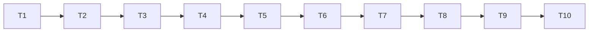

# Tasks: Phase 7, harness configurations

Status: **done** (2026-10-11). See [README.md](README.md) and [RUN.md](RUN.md).

| Task | Status |
|------|--------|
| T1-T8 | done; T8 timing recorded in the README (AC-10) |
| T9 | done: AC-11 passes on attempt 3 (16 patches on a 64-location ring), after attempts 1-2 failed the ceiling test and a review with the user; larger maps tried and logged; quick and full demo run (AC-12) |
| T10 | done except the paper slow-demo hash re-run (AC-13); Phase 6 `demo_team` hashes unchanged; `README.md` updated by hand because `nbdev-readme` fails in the local Quarto install |

Rules for every task:

- Write code and tests in the notebook, then run `nbdev-export` and `nbdev-test --n-workers 0` (one notebook per call when naming notebooks; `.venv/bin` first on `PATH`).
- A task is done only when its tests pass and all earlier tests still pass, including the Phase 5 golden fixtures, the six paper-demo hashes and the Phase 6 `demo_team` hashes.
- Keep each exported file under about 200 lines.
- Section numbers below refer to [design-low-level.md](design-low-level.md).
- **T9 is a gate for Phase 8**: the Phase 8 spec is not finalised before the harness check passes and the *(check)* defaults are filled in.

## Order

## T1. Phase 6 baseline
- **Files**: new `tools/phase6_demo_hashes.sh`; output `results/multiagent/baseline_phase6/` (gitignored).
- **What**: run `demo_team` quick and full on the current commit and record the `metrics.json` hashes (section 1), as the Phase 5 baseline did.
- **Done when**: `sha256.txt` holds both hashes and a second run gives the same hashes (the demo is deterministic).

## T2. Phase 6 amendments
- **Files**: `nbs/team_agents.ipynb`, `nbs/patchworld.ipynb`.
- **What**: `banditAgent._stats()`; `CircuitPatchMember.reward` keeps `net`; `fixate` sets `loc[i]` (section 1).
- **Tests**: Phase 6 tests (including AC-1 sanity bridge); a circuit member's `world.loc` follows its heading.
- **Done when**: tests pass and the Phase 6 demo hashes equal `results/multiagent/baseline_phase6/sha256.txt`.

## T3. Blackboard
- **Files**: new `nbs/harness.ipynb` (exports `explRL/harness.py`).
- **What**: `Blackboard` with `stats` (section 2).
- **Tests**: **AC-3**.

## T4. Message bus
- **Files**: `nbs/harness.ipynb`.
- **What**: `MessageBus` (section 3).
- **Tests**: **AC-4** (the "own best estimate" part is tested in T6 with `CommBandit`).

## T5. Lead
- **Files**: `nbs/harness.ipynb`.
- **What**: `Lead` (section 4).
- **Tests**: **AC-5** (worked check, compared with `idealFree`; unknown locations nearest first; own assignment not counted).

## T6. Bandit members
- **Files**: new `nbs/harness_agents.ipynb` (exports `explRL/harness_agents.py`).
- **What**: `CommBandit`, `LeadFollower` (section 5).
- **Tests**: **AC-1** (bridge to `banditAgent`, including the blackboard with `w = 0`); **AC-6**; the message part of **AC-4**; a `LeadFollower` team goes where the lead assigns and reports every stay.

## T7. Circuit member
- **Files**: `nbs/harness_agents.ipynb`.
- **What**: `CircuitCommMember` (section 6).
- **Tests**: **AC-2** (both scenes, seeds 0-2, 300 s, `None` and `w = 0`); **AC-7**; a `Lead` raises `TypeError`.

## T8. Runs, budgets and speed
- **Files**: new `nbs/harness_runs.ipynb` (exports `explRL/harness_runs.py`).
- **What**: `HarnessConfig`, `benchWorld`, `circuitWorld`, `worldTime`, `makeChannel`, `makeTeam`, `runHarness`, `harnessMetrics`, `rangeCheck` (section 7).
- **Tests**: **AC-8**; **AC-9** (all four channels plus a circuit team); **AC-10** (time a 64-agent blackboard team, 600 s; record the time and the cost per event in this file and the README).
- **Done when**: tests pass, with the timing recorded.

## T9. Harness check and demo (gate for Phase 8)
- **Files**: new `nbs/demo_harness.ipynb`; `nbs/sidebar.yml` (add `harness`, `harness_agents`, `harness_runs`, `demo_harness`).
- **What**: section 8. The full run includes the harness check (AC-11).
- **Done when**:
  - **AC-11** passes; if it does not, change the `benchWorld()` settings (patch count, `Tmove`, travel scale, noise, more locations), rerun, and record every attempt in the README; fill in the *(check)* defaults. If nothing passes after a few rounds, stop and review the plan with the user;
  - **AC-12**: the quick run is in normal tests (under 15 s) and the full run works with `--flags slow` (under 20 min), both writing their figures, `metrics.json` and `report.md`.

## T10. Final regression and docs
- **What**:
  - run the full suite, the three paper slow demos and the `demo_team` quick and full runs; check **AC-13** (paper and Phase 6 hashes unchanged, all tests pass, line counts, no new dependencies);
  - write `specs/multiagent/phase7/RUN.md` (same layout as the other RUN files);
  - set this spec's status to implemented with the measured results (harness check, channel comparison, evaporation, budgets, timings); mark Phase 7 done in [../README.md](../README.md) and record decisions Q5 and Q8 there;
  - link `nbs/demo_harness.ipynb` and `RUN.md` from `nbs/index.ipynb` and the other `RUN.md` files; run `nbdev-readme`.
- **Done when**: all checks pass and the docs are updated.

## Acceptance criteria to task map

| AC | Task |
|----|------|
| AC-1 | T6 (Phase 6 hashes in T2) |
| AC-2 | T7 |
| AC-3 | T3 |
| AC-4 | T4 (message content in T6) |
| AC-5 | T5 |
| AC-6 | T6 |
| AC-7 | T7 |
| AC-8, AC-9, AC-10 | T8 |
| AC-11, AC-12 | T9 |
| AC-13 | T10 |
