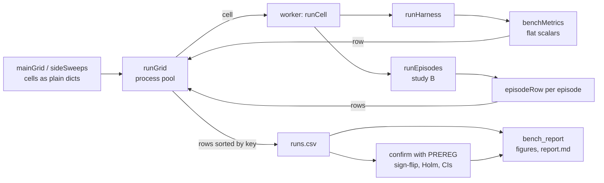

# High-level design: Phase 8, benchmark and eval suite

## Components

The plan named `explRL/bench.py` and a report generator. They are split to keep each file under 200 lines.

| Module | New / changed | Contents |
|---|---|---|
| `nbs/team_refs.ipynb` -> `explRL/team_refs.py` | changed | adds `ifdDistanceTies` (no change to existing functions) |
| `nbs/harness.ipynb` -> `explRL/harness.py` | changed | adds `Blackboard.rebase` |
| `nbs/harness_runs.ipynb` -> `explRL/harness_runs.py` | changed | `harnessMetrics` uses `ifdDistanceTies` and adds `a`, `c`, `nCirc` to circuit estimates; `benchWorld(shape=...)` |
| `nbs/bench_metrics.ipynb` -> `explRL/bench_metrics.py` | new | `recovery`, `beliefs`, `goalSpread`, `discoveries`, `freeRiding`, `findTime`, `overlap`, `followTime`, `benchMetrics` |
| `nbs/bench_stats.ipynb` -> `explRL/bench_stats.py` | new | `bootCI`, `signFlipP`, `holm`, `cohenDz`, `scalingFit` |
| `nbs/bench_grid.ipynb` -> `explRL/bench_grid.py` | new | `Cell`, `mainGrid`, `sideSweeps`, `runCell`, `runGrid`, `writeCSV`, `readCSV`, `PREREG`, `confirm` |
| `nbs/episodes.ipynb` -> `explRL/episodes.py` | new | `LevelBandit`, `runEpisodes`, `episodeRow` |
| `nbs/bench_report.ipynb` -> `explRL/bench_report.py` | new | summaries from rows (`byN`, `perSize`, `slopes`, `sweepTable`, `circuitTable`, `teamOptimal`, `studyB`) and the `report.md` text |
| `nbs/bench_figures.ipynb` -> `explRL/bench_figures.py` | new | figures (`mainFigures`, `sweepFigures`); split from `bench_report` to stay under 200 lines |
| `nbs/demo_harness.ipynb` | changed | its IFD series uses `ifdDistanceTies` (FR-2) |
| `nbs/demo_bench.ipynb` | new | quick grid (normal tests), main grid (`slow`), sweeps and studies (`sweeps`) |
| `pyproject.toml` | changed | `tst_flags = "notest slow sweeps"` |
| `tools/phase7_demo_hashes.sh` | new | hashes the Phase 7 `demo_harness` `metrics.json` files (T1) |

Import rule: `bench_metrics` imports `team_refs` and `numpy` only; `bench_stats` imports `numpy` only; `episodes` imports `harness`, `harness_agents`, `harness_runs`, `credit`, `multi` and `bench_metrics`; `bench_grid` imports `harness_runs`, `bench_metrics`, `bench_stats` and `episodes`; `bench_report` imports `bench_stats`; `bench_figures` imports `bench_report`, `bench_stats` and `matplotlib`. No module imports a demo.

## Data flow

Workers receive and return plain dicts, so nothing large is pickled and a row depends only on its cell. All analysis reads the CSV, so the report can be rebuilt without rerunning anything.

## Main decisions

**D1. Pre-register, then run unseen seeds (B2, B6).** Phase 7 already looked at seeds 0-9 and found the blackboard best. Testing that again on the same seeds would be circular. The confirmatory contrasts, sizes, statistic, `delta` and seeds are a constant (`PREREG`) committed before seeds 100-129 are run; its hash and the commit go into every report. Rejected: choosing tests after looking at the grid (garden of forking paths).

**D2. One summary per seed per test (B6).** Each confirmatory test averages its contrast over the listed team sizes within a seed, then tests the 30 per-seed numbers. One test per hypothesis keeps the family at three, so Holm costs little power. Rejected: a test per team size (21 tests, little power after correction) or a mixed model (needs a statistics library).

**D3. Sign-flip permutation tests and percentile bootstrap (FR-10).** Both work with 30 paired values without distributional assumptions and need only numpy. Rejected: t-tests (welfare differences are skewed at small sizes) and `scipy` (a new dependency).

**D4. A tie-invariant IFD distance (B4).** The benchmark world has four patches of each intake. Any allocation that puts the right number of agents on each intake group is an ideal free distribution, but the Phase 6 distance compares with one of them. Sorting occupancy and target within each group gives the minimum distance over relabellings. It changes Phase 7's IFD metrics (recorded) and nothing in Phase 6.

**D5. A censored recovery time for H1 (B5).** No team reaches the old 0.2 threshold between 40 s moves, so the old time to IFD is undefined. Counting a period that never reaches `delta` as `Tmove` gives a restricted mean that is always defined, ranks "never" below "late", and keeps the plan's meaning ("time to get within a set distance"). `delta` is calibrated on pilot seeds so the test is neither all-censored nor trivial.

**D6. Metrics from the ledger, after the run (B8).** Discoveries, free riding, find time, overlap and follow time are computed from the world's ledger, so they exist for every team, need no change to agents, and match the `Credit` rule used in study B.

**D7. Parallel seeds, unchanged agents (B3).** The pilot puts the main grid at about 31 CPU-minutes. Eight processes bring it to about 4-5 minutes. Rewriting `banditAgent` with running sums would be faster but changes floating-point results and the Phase 6 hashes.

**D8. Study B learns a level per episode, not per event (B11).** The Phase 7 pilots showed that switching exploration mode or level every event, with warm-up, cost more than it gained. A level fixed for a whole episode is a coherent strategy, its value is measured over a whole episode (so credit from late finds counts), and round-robin starting levels with an agent offset give every early team a mix of levels. This is the "persistent exploration level" the plan asked for.

**D9. Exploratory work is clearly separated (B9-B11).** Side sweeps and studies use other seeds (200-209), report intervals but no p-values, and are labelled exploratory in the report.

## Risks

| Risk | Effect | Mitigation |
|---|---|---|
| The confirmatory runs are repeated or the plan changes after seeing data | Inflated false positives | `PREREG` committed before T9; the report prints its hash and the commit; any change is listed as a deviation |
| `delta` calibration makes H1 trivially significant or all-censored | H1 meaningless | Calibrated on pilot seeds with a stated rule (AC-8); the share of periods reaching `delta` is reported per channel |
| Averaging over sizes hides a reversal at some size | Misleading summary | Per-size estimates and CIs are always shown next to the confirmatory result (exploratory) |
| Belief diversity is low with a blackboard by construction (every agent reads the same board) | H2 looks trivial | That is the Lorenz et al. mechanism being tested; the report shows belief error next to diversity, so herding (low diversity, high error) is visible |
| Study B learns too slowly in 12 episodes (4 are round-robin) | No visible learning | Learning curves and the level spread are shown per episode; a longer sequence is an on-demand option |
| Parallel runs differ from serial runs | Non-reproducible CSV | Each cell seeds its own generators; rows sorted by key; AC-5 compares 1 and 4 workers byte for byte |
| Grid takes longer than measured (other load, slower machine) | Misses the 10 minute target | Time recorded; quick mode always under 30 s; workers configurable |
