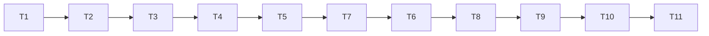

# Tasks: Phase 8, benchmark and eval suite

Status: in progress. Done: T1, T2, T3, T4, T5, T7, T6.

Tasks run in the order of the diagram below; T7 comes before T6 because T6 needs it (the numbers are kept, since the README and requirements refer to T6 as the gate).

Rules for every task:

- Write code and tests in the notebook, then run `nbdev-export` and `nbdev-test --n-workers 0` (one notebook per call when naming notebooks; `.venv/bin` first on `PATH`).
- A task is done only when its tests pass and all earlier tests still pass, including the Phase 5 golden fixtures, the paper-demo hashes and the Phase 6 `demo_team` hashes.
- Keep each exported file under about 200 lines.
- Section numbers below refer to [design-low-level.md](design-low-level.md).
- Experiment scripts that use `multiprocessing` are files, never piped through stdin (spawned workers re-import the main module).
- **T6 is a gate:** no confirmatory seed (100-129) is run before `PREREG` is committed.

## Order

## T1. Phase 7 baseline
- **Files**: new `tools/phase7_demo_hashes.sh`; output `results/multiagent/baseline_phase7/` (gitignored).
- **What**: run `demo_harness` quick and full on the current commit and record the `metrics.json` hashes, as T1 of Phase 7 did for Phase 6.
- **Done when**: `sha256.txt` holds both hashes and a second run gives the same hashes.

## T2. Amendments
- **Files**: `nbs/team_refs.ipynb`, `nbs/harness.ipynb`, `nbs/harness_runs.ipynb`, `nbs/demo_harness.ipynb`, `pyproject.toml`.
- **What**: `ifdDistanceTies`; `harnessMetrics` uses it and adds `a`, `c`, `nCirc` to circuit estimates; `demo_harness`'s IFD series uses it; `Blackboard.rebase`; `benchWorld(shape=...)`; add `sweeps` to `tst_flags` (section 1).
- **Tests**: **AC-2**; the rebase part of **AC-6**; a torus `benchWorld` has 64 locations and passes a short run.
- **Done when**: tests pass; Phase 6 hashes unchanged; `demo_harness` re-run and its `metrics.json` differs from the T1 baseline only in its IFD-derived fields (**AC-1**); the new values recorded in the Phase 7 README.

## T3. Metrics
- **Files**: new `nbs/bench_metrics.ipynb` (exports `explRL/bench_metrics.py`).
- **What**: `recovery`, `beliefs`, `discoveries`, `freeRiding`, `findTime`, `overlap`, `followTime`, `benchMetrics` (section 2).
- **Tests**: **AC-3**; `discoveries` on a `runCredit` run equals the `Credit` object's counts; a `benchMetrics` row has only scalar values.

## T4. Statistics
- **Files**: new `nbs/bench_stats.ipynb` (exports `explRL/bench_stats.py`).
- **What**: `bootCI`, `signFlipP`, `holm`, `cohenDz`, `scalingFit` (section 3).
- **Tests**: **AC-4**.

## T5. Grid
- **Files**: new `nbs/bench_grid.ipynb` (exports `explRL/bench_grid.py`).
- **What**: cells, `mainGrid`, `sideSweeps`, `runCell`, `runGrid`, `writeCSV`, `readCSV`, `confirm` (section 4), with `PREREG` holding the provisional `delta`.
- **Tests**: **AC-5** (cell counts and factors; quick grid under 30 s; CSV round-trip; byte-identical CSV for 1 and 4 workers; `sideSweeps('quick')` runs every runner path, which needs T7's `runEpisodes`, so that test is added in T7); **AC-7**, including `confirm(rows, PREREG, seeds=...)` on quick rows.

## T7. Study B pieces
- **Files**: new `nbs/episodes.ipynb` (exports `explRL/episodes.py`).
- **What**: `LevelBandit`, `runEpisodes`, `episodeRow` (section 5).
- **Tests**: **AC-6**; the `sideSweeps('quick')` part of **AC-5**; fixed arms never change level; `levelStable` is 1 for a fixed arm; two runs of one sequence give identical rows; a `strategy` sequence keeps level statistics but starts each episode with empty map state; an `all` sequence's first view in episode 2 equals the board's faded state from episode 1.

## T6. Calibration and freeze (gate; after T7, which the `cLevel` check needs)
- **Files**: a scratch script (not committed); `nbs/bench_grid.ipynb`; this spec's README.
- **What**: on pilot seeds 1000-1009, run the fixed-compute main-grid cells for `none` and `blackboard` and apply the AC-8 rule to choose `delta`; check `cLevel` on a short study B pilot (seeds 1000-1002, 12 episodes, N = 16) so levels do not lock in after the round robin; set both in code and remove their *(check)* marks.
- **Done when**: **AC-8** recorded in the README (the share of periods reaching each candidate `delta`); `PREREG` final; the spec, the code and the README committed, with the commit hash written into the README. From here on any change to `PREREG` is a reported deviation.

## T8. Report
- **Files**: new `nbs/bench_report.ipynb` (exports `explRL/bench_report.py`); new `nbs/demo_bench.ipynb`; `nbs/sidebar.yml` (add the new notebooks).
- **What**: figures and `report.md` (section 6); the demo's quick section (section 7).
- **Tests**: the quick demo runs in normal tests in under 30 s and writes `runs.csv`, `metrics.json`, `report.md` and figures; the report prints the `PREREG` hash and labels the quick verdicts as a pipeline check.

## T9. Main grid and confirmatory analysis
- **What**: run `nbdev-test --n-workers 0 --flags slow nbs/demo_bench.ipynb` once on the frozen `PREREG`.
- **Done when**: **AC-9**: under 10 minutes, time recorded; the confirmatory table, per-size estimates and scaling slopes are in `report.md` and in this spec's README, whatever the verdicts. If it has to be rerun (crash, bug), the README says why and what changed.

## T10. Side sweeps and studies
- **What**: run with `--flags sweeps`.
- **Done when**: **AC-10**: under 60 minutes, time recorded; the team-optimal `cUCB` per channel and size, the reward-scheme comparison, study B's learning curves and gap closed, and the side-sweep findings are in the README, labelled exploratory.

## T11. Final regression and docs
- **What**:
  - run the full suite, the paper slow demos, `demo_team` quick and full and `demo_harness` quick and full; check **AC-11** and the hashes;
  - write `specs/multiagent/phase8/RUN.md` (same layout as the other RUN files);
  - set this spec's status to implemented with the measured results; mark Phase 8 done in [../README.md](../README.md), record decision Q9 there, and correct the plan's Phase 8 run-time paragraph with the measured numbers;
  - link `nbs/demo_bench.ipynb` and `RUN.md` from `nbs/index.ipynb`, `README.md` and the other multi-agent `RUN.md` files.
- **Done when**: all checks pass and the docs are updated.

## Acceptance criteria to task map

| AC | Task |
|----|------|
| AC-1 | T2 |
| AC-2 | T2 |
| AC-3 | T3 |
| AC-4 | T4 |
| AC-5 | T5 |
| AC-6 | T2 (rebase), T7 |
| AC-7 | T5 |
| AC-8 | T6 |
| AC-9 | T9 |
| AC-10 | T10 |
| AC-11 | T11 |
