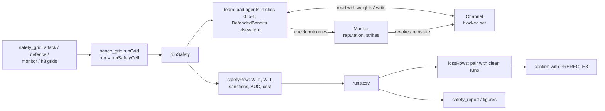

# High-level design: Phase 9, safety and mechanism design

## Components

The plan named `explRL/adversary.py` for bad agents and defences. Defences, runs and reporting get their own modules to keep each file under 200 lines.

| Module | New / changed | Contents |
|---|---|---|
| `nbs/harness.ipynb` -> `explRL/harness.py` | changed | `Blackboard.blocked`, `Blackboard.viewBy`; `MessageBus.blocked` (empty by default: no behaviour change) |
| `nbs/bench_grid.ipynb` -> `explRL/bench_grid.py` | changed | `runGrid(..., run=runCell)`; `confirm` reads the study from the pre-registration (default `'main'`) |
| `nbs/adversary.ipynb` -> `explRL/adversary.py` | new | `ReportLog` (report log for the white-box score), `Liar`, `FreeRider`, `Saboteur`, `LeadLiar`, `LeadFreeRider`, `LeadSaboteur` |
| `nbs/defence.ipynb` -> `explRL/defence.py` | new | `Monitor` (reputation, strikes, sanctions), `DefendedBandit` (weighted reads, checks, spot-check trips, report log) |
| `nbs/safety_runs.ipynb` -> `explRL/safety_runs.py` | new | `SafetyConfig`, `makeTeam9`, `runSafety`, `safetyRow`, `auc`, `lossRows` |
| `nbs/safety_grid.ipynb` -> `explRL/safety_grid.py` | new | `attackGrid`, `defenceGrid`, `monitorGrid`, `h3Grid`, `runSafetyCell`, `PREREG_H3` |
| `nbs/safety_report.ipynb` -> `explRL/safety_report.py` | new | `group`, `costBenefit`, `summaries` and the `report.md` text |
| `nbs/safety_figures.ipynb` -> `explRL/safety_figures.py` | new | `safetyFigures` (all figures from the summary tables) |
| `nbs/demo_safety.ipynb` | new | quick grid (normal tests), H3 (`slow`), exploratory grids (`sweeps`) |
| `tools/phase8_baseline.sh` | new | records the Phase 7 `demo_harness` hashes and the Phase 8 quick `runs.csv` hash after Phase 8 (T1) |

Import rule: `adversary` imports `harness`, `harness_agents`, `team_agents`; `defence` imports `harness`, `harness_agents`, `adversary` (`ReportLog`); `safety_runs` imports `adversary`, `defence`, `harness_runs`, `bench_metrics`, `multi`, `team_refs`; `safety_grid` imports `safety_runs`, `harness_runs`; `safety_report` imports `bench_report` (formatting helpers), `bench_stats` and `safety_runs` (`lossRows`); `safety_figures` imports `matplotlib` and `numpy` only (it draws from the summary tables). No module imports a demo.

## Data flow

## Main decisions

**D1. Bad agents are honest learners with one deviation (C1).** A liar still learns from its own stays and reads the channel; only what it reports is false. This keeps its own behaviour realistic (it is not obviously different on the map), makes the white-box test meaningful (its beliefs are honest, its reports are not) and gives each type exactly one way to do harm: false information (liar), taking without giving (free-rider), crowding (saboteur). Rejected: random or always-maximal lies (easy to spot, and not what the plan describes) and adaptive liars (out of scope).

**D2. Honest welfare is the harm measure; team welfare is reported next to it (C3).** The question is what bad agents cost the others. The pilot showed that free-riders and saboteurs can raise honest welfare per agent while lowering the team's total (they idle or crowd one patch and leave the rest to fewer competitors), so both numbers are needed to read those results. Relative loss pairs each attacked run with a clean run on the same seed, so world differences cancel.

**D3. Defences act on reading, sanctions act on the channel (C4).** Trust and reputation change how much a reader believes each sender; sanctions also change what the channel accepts. Keeping the board's per-writer sums (already there) makes weighted reads exact and cheap. Rejected: removing a sanctioned writer's past entries (fading already ages them; their weight is set to 0 while revoked).

**D4. Monitoring has a price (C5).** Ostrom's point is that monitoring is costly and must pay for itself. Deliberate checks take agents away from foraging, and their agent-seconds are counted, so "trust vs sanctions at the same monitoring cost" is a fair comparison. Incidental checks (stays an agent made anyway) are free.

**D5. H3 is its own pre-registered family on new seeds (C9).** Phase 8 fixed H3's contrast and sign; Phase 9 fixes its cells before running: no defence (H3 is about the harness, not the defences), fixed compute (the headline budget), sizes 8, 16 and 32 (one liar is a minority, and messages teams earn enough for a stable relative loss), relative loss (the blackboard's higher baseline would otherwise inflate its absolute loss). The pilot gives dz about 1.85 on 12 seeds, so 30 seeds leave little risk of a false "not significant".

**D6. Reuse Phase 8's machinery (C12).** The grid runner, CSV and `confirm` already give determinism, parallelism and the statistics; two small, backward-compatible amendments let Phase 9 use them without touching Phase 8's frozen pre-registration.

## Risks

| Risk | Effect | Mitigation |
|---|---|---|
| Honest agents get sanctioned (crowding, noise and patch moves make honest reports disagree with later checks) | Sanctions hurt the honest team | `theta` calibrated to keep false sanctions at or below 5% of clean runs (C11); strikes count only for 120 s; false-sanction rates reported |
| Defences cost more than they save | A defence looks good only under attack | Every defence is run with no bad agents too; cost without attack is reported next to benefit under attack |
| White-box detection is trivially perfect for numpy agents (we read their state) | The AUC says little | Reported as the ceiling that interpretability gives, next to black-box AUC from the defences; Phase 10 asks whether anything similar is possible for language models |
| H3 is driven by the messages channel being weak, not by the blackboard being fragile | Misleading reading | Absolute losses and per-size losses reported next to the confirmatory contrast |
| Saboteurs and free-riders hardly matter in this world | Little to report for them | Reported as a finding (the pilot already suggests it), with team welfare showing the cost to the total |
| Grids slower than estimated (trust reads cost an extra `(n x L)` product) | Misses 30 minutes | Measured in T5; grids trimmed to fewer sizes if needed |
