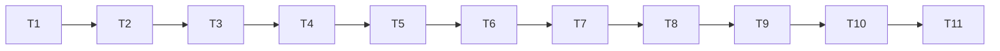

# Tasks: Phase 9, safety and mechanism design

Status: **done** (2026-10-11). All tasks complete; results in [README.md](README.md).

Rules for every task:

- Write code and tests in the notebook, then run `nbdev-export` and `nbdev-test --n-workers 0` (one notebook per call when naming notebooks; `.venv/bin` first on `PATH`).
- A task is done only when its tests pass and all earlier tests still pass, including the Phase 5 golden fixtures, the paper-demo hashes, the Phase 6 `demo_team` hashes and the T1 baseline.
- Keep each exported file under about 200 lines.
- Section numbers below refer to [design-low-level.md](design-low-level.md).
- Experiment scripts that use `multiprocessing` are files, never piped through stdin.
- **T7 is a gate:** no H3 seed (300-329) is run before `PREREG_H3` is committed.

## Order

## T1. Baseline after Phase 8
- **Files**: new `tools/phase8_baseline.sh`; output `results/multiagent/baseline_phase8/` (gitignored).
- **What**: run `demo_harness` quick and full and `demo_bench` quick on the current commit (from a clean worktree), record the `demo_harness` `metrics.json` hashes and the hash of `bench/quick/runs.csv`.
- **Done when**: `sha256.txt` holds the three hashes and a second run gives the same.

## T2. Amendments
- **Files**: `nbs/harness.ipynb`, `nbs/bench_grid.ipynb`.
- **What**: `blocked` and `viewBy` on `Blackboard`, `blocked` on `MessageBus`; `runGrid(..., run=)`; `confirm` study key (section 1).
- **Tests**: **AC-2**; `preregHash()` is still `8a59293847ae`; `confirm` on Phase 8 rows gives the recorded verdicts.
- **Done when**: tests pass and the T1 hashes are unchanged.

## T3. Bad agents
- **Files**: new `nbs/adversary.ipynb` (exports `explRL/adversary.py`).
- **What**: `Liar`, `FreeRider`, `Saboteur` and the lead variants, with the report log (section 2).
- **Tests**: **AC-3**.

## T4. Defences
- **Files**: new `nbs/defence.ipynb` (exports `explRL/defence.py`).
- **What**: `Monitor`, `DefendedBandit` (section 3).
- **Tests**: **AC-4** (including a third strike within 120 s revoking, and reinstatement once strikes leave the window); `DefendedBandit` with `'none'` and `q = 0` chooses exactly as `CommBandit` on a short run, for blackboard and messages, while still logging its reports.

## T5. Runs and metrics
- **Files**: new `nbs/safety_runs.ipynb` (exports `explRL/safety_runs.py`).
- **What**: `SafetyConfig`, `makeTeam9`, `runSafety`, `safetyRow`, `auc`, `lossRows` (section 4).
- **Tests**: **AC-1** (bridge to `runHarness`); **AC-5**; time a 64-agent blackboard run with sanctions and `q = 0.05` and record the cost per event.

## T6. Grids
- **Files**: new `nbs/safety_grid.ipynb` (exports `explRL/safety_grid.py`).
- **What**: the four grids, `runSafetyCell`, row keys, `PREREG_H3` (section 5).
- **Tests**: **AC-6**.

## T7. Calibration and freeze (gate)
- **Files**: a scratch script (not committed); `nbs/safety_runs.ipynb` (`theta` default), `nbs/safety_grid.ipynb`; this spec's README.
- **What**: on pilot seeds 1000-1009, run clean blackboard and messages teams with sanctions (`q = 0.05`, N = 16 and 64) for each candidate `theta` and apply the C11 rule; record the false-sanction rates (and, for information, the share of liars revoked in 25%-liar runs); set `theta`, remove its *(check)* mark.
- **Done when**: **AC-7** recorded in the README; spec, code and README committed with the commit hash and the `PREREG_H3` hash written into the README.

## T8. Report and quick demo
- **Files**: new `nbs/safety_report.ipynb`, `nbs/safety_figures.ipynb`, `nbs/demo_safety.ipynb`; `nbs/sidebar.yml`.
- **What**: summaries, figures and report (section 6); the demo's quick section (section 7).
- **Tests**: the quick demo runs in normal tests in under 30 s and writes all artifacts; the report labels the quick H3 verdict as a pipeline check.

## T9. H3 (confirmatory)
- **What**: run `nbdev-test --n-workers 0 --cell-timeout 0 --flags slow nbs/demo_safety.ipynb` once on the frozen `PREREG_H3`.
- **Done when**: **AC-8**: verdict, mean, CI, dz, p and per-size losses (absolute and relative) in `report.md` and in this spec's README, whatever they are.

## T10. Exploratory grids
- **What**: run with `--cell-timeout 0 --flags sweeps`.
- **Done when**: **AC-9**: under 30 minutes, time recorded; the attack, defence, monitoring and detection findings in the README, labelled exploratory.

## T11. Final regression and docs
- **What**:
  - run the full suite, the paper slow demos, `demo_team`, `demo_harness` and `demo_bench` quick; check **AC-10** and the T1 hashes;
  - write `specs/multiagent/phase9/RUN.md`;
  - set this spec's status to implemented with the results; mark Phase 9 done in [../README.md](../README.md) with its H3 result, and update its effort estimate;
  - link `nbs/demo_safety.ipynb` and `RUN.md` from `nbs/index.ipynb`, `README.md` and the other multi-agent `RUN.md` files; add a plain-language figure guide to the results, as for Phase 8.
- **Done when**: all checks pass and the docs are updated.

## Acceptance criteria to task map

| AC | Task |
|----|------|
| AC-1 | T5 (hashes in T2, T11) |
| AC-2 | T2 |
| AC-3 | T3 |
| AC-4 | T4 |
| AC-5 | T5 |
| AC-6 | T6 |
| AC-7 | T7 |
| AC-8 | T9 |
| AC-9 | T10 |
| AC-10 | T11 |
