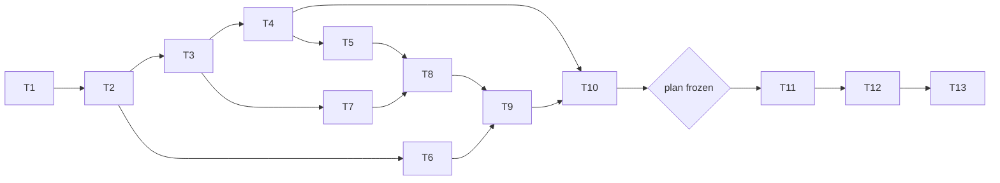

# Tasks: faster live runs and follow-up experiments

Status: done (2026-10-12) except D1 main (T12), paused by the user after the D1 pilot found no qualifying level; see the README.

Rules for every task:

- Write code and tests in the notebook, then run `nbdev-export` and `nbdev-test --n-workers 0` (one notebook per call when naming notebooks; `.venv/bin` first on `PATH`); after `nbdev-export`, restore modules whose only change is the cell-id comments.
- A task is done only when its tests pass and all earlier tests still pass, including the Phase 5-9 baselines and, from T5 on, the Phase 10 reference hashes.
- Keep each exported file under 200 lines.
- Section numbers below refer to [design-low-level.md](design-low-level.md).
- Normal tests never call the API (fake client) and run without `anthropic`.
- **Gate:** no live call before `FOLLOWUP_PLAN` is frozen and committed (T10); the cap ($150, of which $33.50 spent) is enforced by FR-A4.

## Order

## T1. Baselines and references
- **What**: from a clean worktree of the current `main`, run `tools/phase9_baseline.sh`; record the hashes of the current Phase 10 `results/multiagent/llm/full/{runs.csv,turns.jsonl}` and keep a copy of that `runs.csv` as `full/runs_before_teamrate.csv`.
- **Done when**: the baseline matches `results/multiagent/baseline_phase9/sha256.txt`; the Phase 10 hashes are written down (they equal the AC-9 check of 2026-10-12).

## T2. Team metrics (Part C, offline)
- **Files**: new `nbs/team_time.ipynb`; `nbs/taskboard.ipynb` (`netRows`); `nbs/llm_runs.ipynb` (`taskMetrics`); `nbs/llm_compare.ipynb` (`runNumpy`) (section 4).
- **What**: `teamRates`, `teamColumns`, `marginalGain`, `teamRateCell`; `TaskBoardEnv.netRows`; Part C columns in Phase 10 rows.
- **Tests**: **AC-7**; `teamWelfare == welfare x N x turns` on fake runs of both tasks; `netRows` sums to `netByAgent().sum()`.

## T3. Budget split and client hooks (Part A)
- **Files**: new `nbs/llm_budget.ipynb`; `nbs/llm_client.ipynb`; every notebook importing pricing or the budget from `llm_client` (sections 1, 2).
- **What**: move pricing and the budget to `llm_budget`; `maxCallCost`; `LLMClient(floor, timing)`, `LLMClient.tag`, `complete(..., task)`; `RetryCounter`.
- **Tests**: Phase 10 client tests unchanged in substance; the floor refuses a call that would leave less than it; a timing record per call (live and cached); `RetryCounter` counts a simulated SDK retry message; `llm_client` imports and runs without `anthropic`.

## T4. Rounds and territories (Part B, offline)
- **Files**: new `nbs/rounds.ipynb`, `nbs/territory.ipynb`; `nbs/llm_agent.ipynb` (three phases, home sentence); `nbs/llm_env.ipynb` (home first); `nbs/llm_runs.ipynb`, `nbs/llm_compare.ipynb` (`protocol`, `window`, `squads`, `beta`, fixed-time numpy rows) (sections 5-7).
- **What**: `runRounds`; `prepare / decide / commit` for `LLMMember` and `CommBandit`; `homeRanges`, `TerritoryBandit`, `homeShare`; LLM home ranges; config fields and rows.
- **Tests**: **AC-5**, **AC-6**; event-driven Phase 10 quick runs send the same requests as before (request keys compared) and keep every existing column's values; the new config columns are the only difference (the full outputs are regenerated once, in T5).

## T5. Regenerate Phase 10 outputs (Part C, from the cache)
- **What**: rerun the Phase 10 full mode from the cache with T2's and T4's code (every change to row shape comes before this one regeneration) (`demo_llm` main section with `EXPLRL_LLM_LIVE=1`; the ledger must not grow); compare every column of `runs_before_teamrate.csv` with the new `runs.csv`; record the new hashes in Phase 10 `RUN.md` as the AC-9 reference.
- **Done when**: **AC-8** (Phase 10 part): no request, existing columns identical; new hashes recorded.

## T6. Phase 8-9 team rates (Part C, numpy reruns)
- **Files**: `nbs/team_time.ipynb` (grids and checks); outputs `results/multiagent/{bench,safety}/teamrate/` (section 4).
- **What**: rerun the Phase 8 main grid and the Phase 9 attack grid with `teamRateCell`; compare original columns with the saved CSVs.
- **Done when**: **AC-8** (Phase 8-9 part): every original column identical; the confirmatory folders untouched (their hashes unchanged).

## T7. Scheduling (Part A)
- **Files**: new `nbs/llm_sched.ipynb`; `nbs/bench_grid.ipynb` (`chunksize`); `nbs/llm_runs.ipynb` (`makeClient`: floor; `runLLMCell`: client tag, per-run timing file); `nbs/demo_llm.ipynb` (`run` via `runWorkload`, `LLM_WORKERS`, timing outputs) (sections 2, 3).
- **What**: `seqCalls`, `orderCells`, `checkWorkload`, `runWorkload`, `mergeTiming`, `timingSummary`; installing `RetryCounter` in each worker.
- **Tests**: **AC-1** on the Phase 10 quick workload (1, 8, 32 processes; ordered and unordered; pooled and grid by grid; byte-identical); **AC-3**; **AC-4**; `orderCells` puts an 8-agent board run before a 1-agent foraging run and numpy runs last.

## T8. Byte identity on the full mode (Part A)
- **What**: rerun the regenerated Phase 10 full mode from the cache at 1, 8 and 32 processes, pooled and grid by grid.
- **Done when**: **AC-9**: byte-identical to T5's reference, no request.

## T9. Regression
- **What**: full suite with and without `anthropic`; Phase 5-9 baselines on a clean worktree.
- **Done when**: **AC-2**.

## T10. Follow-up grids, plan, quick demo and B-numpy
- **Files**: new `nbs/followup_grid.ipynb`, `nbs/followup_report.ipynb`, `nbs/demo_followup.ipynb` (quick and B-numpy sections); `nbs/sidebar.yml` (sections 8, 9).
- **What**: the grids, `chooseHard`, `chooseBeta`, `FOLLOWUP_PLAN`, `followupHash`, `runFollowupCell`; reports and figures; run B-numpy (`--flags slow`); freeze `FOLLOWUP_PLAN` and commit spec, code and plan, with the commit and hash written into this spec's README.
- **Tests**: grid sizes and call counts (section 8 table); the quick demo writes every artifact in under 30 s, byte-identical for 1 and 8 processes; `chooseHard` and `chooseBeta` on synthetic rows.
- **Done when**: B-numpy results saved and `chooseBeta` printed; plan committed (the gate).

## T11. D1 pilot and rate-limit probe (live)
- **What**: re-check prices; run the D1 pilot at `LLM_WORKERS = 32`; read the timing summary (latency, calls/s, retries) and set `LLM_WORKERS` for T12 (raise to 64 if there were no sustained retries); apply `chooseHard` (if `None`, stop and ask the user).
- **Done when**: **AC-10** (first part): timing recorded; settings and the chosen level written into this spec's README.

## T12. Follow-up main runs (live)
- **What**: `hardGrid(chooseHard)`, `effortGrid()`, `roundsGrid(chooseBeta)` as one workload through `runWorkload`.
- **Done when**: **AC-10**: within the cap; cost, calls, retries and wall time recorded; findings in this spec's README, labelled exploratory; a cached rerun of the mode is byte-identical and free.

## T13. Reports and docs
- **What**: `REPORT.md` regenerated by `demo_multiagent` with team totals (Phase 8-10) and the follow-up results; this spec's status and results with a plain-language figure guide; `RUN.md` for this spec (tests, workloads, expected times); Phase 10 `RUN.md` (new reference hashes, `LLM_WORKERS`, timing); the multi-agent plan's status line; links from `nbs/index.ipynb`, `README.md` and the multi-agent `RUN.md` files.
- **Done when**: docs updated; all checks pass.

## Acceptance criteria to task map

| AC | Task |
|----|------|
| AC-1 | T7 |
| AC-2 | T9 (and every task) |
| AC-3 | T7 |
| AC-4 | T7 |
| AC-5 | T4 |
| AC-6 | T4 |
| AC-7 | T2 |
| AC-8 | T5, T6 |
| AC-9 | T8 |
| AC-10 | T11, T12 |
