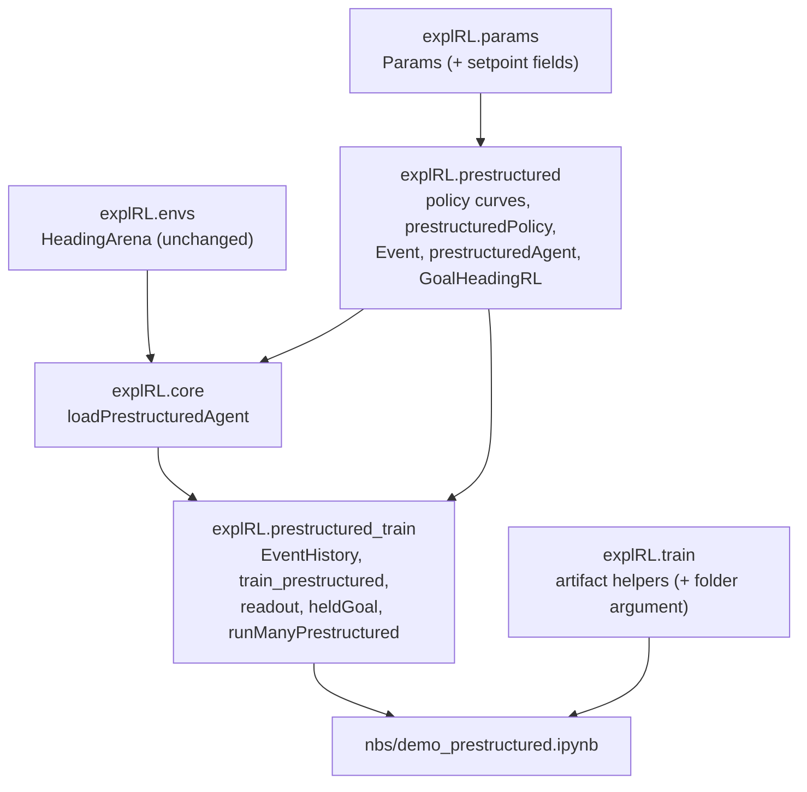

# High-level design: pre-structured (setpoint) policy

## Modules



| Notebook | Exports | Contents |
|---|---|---|
| `nbs/params.ipynb` | `explRL/params.py` | add 8 fields and their checks |
| `nbs/prestructured.ipynb` (new) | `explRL/prestructured.py` | Eq. 20-21 and 23 functions, policy, agent, RL |
| `nbs/prestructured_train.ipynb` (new) | `explRL/prestructured_train.py` | history, training loop, readout, held goal heading, multi-run helper |
| `nbs/00_core.ipynb` | `explRL/core.py` | `loadPrestructuredAgent` |
| `nbs/train.ipynb` | `explRL/train.py` | optional folder argument on the artifact helpers |
| `nbs/demo_prestructured.ipynb` (new) | - | demo, `#| slow` acceptance AC-8 to AC-10 |

The flexible-policy modules (`basis`, `flexibleAgent`, `PolicyGradientRL`, `train_agent`) are not touched.

## One event (data flow)

```mermaid
sequenceDiagram
  participant T as train_prestructured
  participant A as prestructuredAgent
  participant E as HeadingArena
  participant R as GoalHeadingRL
  T->>R: chooseAction(agent)
  R->>A: samplePolicy()
  Note over A: fixation duration ~ IG(aF/nuF(thetaC), aF^2/sigF^2)<br/>direction ~ dS(thetaC), size ~ lognormal<br/>thetaC' = thetaC + dx; jump with pJ(thetaC')
  A-->>T: Event
  T->>E: step(thetaA, dx)
  E-->>T: thetaA', reward r
  T->>R: updateParams(agent, event, r)
  Note over R: thetaG += lrG * r * dlog(dS or 1-dS)/dthetaG
  T->>A: thetaA = thetaA', thetaC = event.thetaC_next
```

Simulated time advances by `fixDur + tS` per event.

## Main decisions

**D1. Event-based simulation, not 1 ms steps.** The SI says that because the goal only changes after saccades, a whole fixation can be drawn at once from an inverse Gaussian. This matches the 1 ms drift-diffusion of the flexible demo in distribution and makes a 240 s run take tens to hundreds of events instead of 240 000 steps. `numpy.random.Generator.wald(mean, scale)` is the inverse Gaussian, so no new dependency.

**D2. Two headings on the agent; the arena stays pure.** The arena only knows the true heading and computes reward (unchanged `HeadingArena`). The compass heading and its jumps are internal to the agent. `samplePolicy` decides the jump itself (it only needs the post-saccade compass heading, which it can compute), and returns the next compass heading in the event; the training loop writes it back. This keeps `env.step` and the existing `Agent` / `RL` split exactly as in the flexible demo.

**D3. The goal heading is the only learned parameter.** It lives on `prestructuredPolicy.thetaG`, in compass coordinates, in radians. Gains and baselines are read from `Params`. A fixed-goal run is just `lrG = 0` (FR-12), so there is one code path for Fig 2h and for learning.

**D4. Analytic readout and simulated readout are both shown.** Eq. 23 gives the Fig 2h curves directly and is deterministic, so it is tested in normal tests (AC-2, AC-3). The simulated readout is a check that the agent really behaves that way. They will not match exactly, for two reasons. Eq. 23 assumes the jump state is redrawn at each arena heading, while in simulation the offset persists between jumps. And Eq. 23 evaluates `pJ` at the heading itself, while the simulation draws the jump at the post-saccade compass heading (as the SI's training procedure says). The prototype shows the size of the difference: the simulated anti-goal peak is 10.6 s against 3.16 s from Eq. 23. Only the qualitative shape (bimodality) is required to match (AC-8).

**D5. Radians and the existing heading convention.** CW increases heading; `dS` is the probability of a CW saccade. With this convention Eq. 20 already turns the agent toward the goal (for a compass heading just CW of the goal, `sin > 0`, so `dS < 1/2`). Because headings are in radians, the gradient in Eq. 25 is per radian; the paper writes `thetaG` in degrees, which would add a factor `pi/180` if copied literally.

**D6. Separate training module.** The flexible `train.py` is close to the 200-line limit and its loop is time-step based. A separate `prestructured_train.py` keeps both small and avoids mixing the two loops.

## Risks

| Risk | Effect | Mitigation |
|---|---|---|
| Q1 / Q2 printed signs are actually right in the published SI | Wrong behaviour or a learning rule that pushes the goal away | Tests AC-2 and AC-4/AC-5 make the consequences visible; check the published SI if available |
| Large goal updates (reward is the step size; Q4) | `thetaG` jumps around and does not settle | `lrG` factor; T9 tuning order: check gradient sign, lower `lrG`, lengthen `Ttot` |
| Few events per 240 s run (11 to 111 in the implementation; long, heavy-tailed fixations near the goal; Q5) | Learning curves are noisy; some runs have no event in the last quarter (happened: 7 of 20) | Average over 20 runs; measure the goal heading over time with `heldGoal`, not over events (AC-9 passes at 240 s) |
| Jumps make the learning signal ambiguous (reward is in arena coordinates, policy in compass coordinates) | AC-10 may not show clear convergence (measured: it does not) | AC-10 is reported, not asserted (decided in T9) |
| Few events per window (prototype: about 170-240 events per window over 20 runs) | Noisy AC-8 | Wide windows (60 degrees) pooled over all runs; prototype margin is large (10.6 s vs 2.5 s) |
