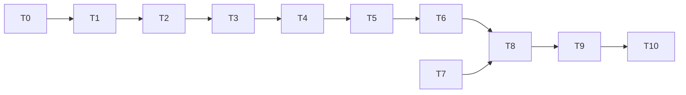

# Tasks: pre-structured (setpoint) policy

Status: all tasks T0-T10 done (2026-10-10). No tuning was needed in T9; one acceptance definition changed (see T9).

Rules for every task:

- Write code and tests in the notebook, then run `nbdev-export` and `nbdev-test --n-workers 0` (with `.venv/bin` first on `PATH`).
- A task is done only when its tests pass and all earlier tests, including the flexible demo's, still pass.
- Keep each exported file under about 200 lines.

## Order

## T0. Confirm open decisions (done)
- **What**: get answers to Q1-Q8 in [README.md](README.md); if the published SI is available, check Eqs. 21 and 25 there.
- **Done when**: answers are written into the README's table as "Decided". Done on 2026-10-10.

## T1. Parameters
- **Files**: `nbs/params.ipynb`.
- **What**: add `GS, BS, GF, BF, GJ, BJ, thetaJ, lrG` with Table 1 defaults and the checks in design-low-level section 1.
- **Tests**: defaults match Table 1; each bad value raises `ValueError`; existing params tests still pass.

## T2. Policy curves and effective readout
- **Files**: new `nbs/prestructured.ipynb` (exports `explRL/prestructured.py`).
- **What**: `wrap`, `angdiff`, `turnProb`, `driftRate`, `jumpProb`, `effectivePolicy` (section 2).
- **Tests**: ranges (`dS` in [0.05, 0.95], `nuF` in [0.05, 0.85], `pJ` in [0.05, 0.75]); `dS < 0.5` just CW of the goal and `> 0.5` just CCW; array and scalar inputs agree; **AC-2** using the values in section 7; **AC-3** with `GJ = BJ = 0`.

## T3. Agent and event sampling
- **Files**: `nbs/prestructured.ipynb`.
- **What**: `prestructuredPolicy`, `Event`, `prestructuredAgent.samplePolicy` with the fixed draw order (sections 3-5).
- **Tests**: `TypeError` for a wrong policy type; `fixDur > 0`; `|dx|` in radians and not rounded; `thetaC_next` is wrapped and `angdiff(thetaC_next, thetaC + dx)` is 0 or pi; a starting heading of `-0.1` is stored as `2*pi - 0.1` for both headings; **AC-6** (CW rate vs `dS`, jump rate vs mean predicted `pJ` at the post-saccade headings, 20 000 calls); mean `fixDur` over 20 000 draws at the anti-goal compass heading within 5% of `aF / nuF` (0.93 s; not at the goal, where draws are too heavy-tailed, see design-low-level section 5); same seed gives the same events.

## T4. Goal-heading learning rule
- **Files**: `nbs/prestructured.ipynb`.
- **What**: `GoalHeadingRL` with `logPiS`, `gradLogPiS`, `updateParams` (section 6), sign from Q2.
- **Tests**: **AC-4** (central finite difference of `logPiS`, CW and CCW, several headings including `thetaG = 0.0`); **AC-5** (with `lr * |r| <= 0.01`, positive / negative reward after a CW saccade raises / lowers `dS`); `lr = 0` leaves `thetaG` unchanged; result always wrapped and finite.

## T5. Loader
- **Files**: `nbs/00_core.ipynb`.
- **What**: `loadPrestructuredAgent` (section 9).
- **Tests**: one seed fixes starting headings and all events; `thetaG0` override works; `learn=False` gives `rl.lr == 0`; `thetaC == theta` at start.

## T6. Training loop, readout, multi-run
- **Files**: new `nbs/prestructured_train.ipynb` (exports `explRL/prestructured_train.py`).
- **What**: `EventHistory`, `train_prestructured`, `relHeading`, `readout`, `heldGoal`, `runManyPrestructured` (section 8).
- **Tests**: total time `t[-1] + fixDur[-1] + tS >= Ttot` and `t[-1] < Ttot`; all arrays same length; `learn=False` keeps `thetaG` constant; **AC-7** (same / different seeds; offset `angdiff(thetaC, thetaA)` always 0 or pi); `relHeading` wraps into `[-180, 180)`; `readout` on a hand-built history gives the expected plain means, turn bias and counts, and `nan` for empty bins; `heldGoal` on a hand-built history gives `thetaG0` before the first update and the held value after each update, with updates at `t + fixDur + tS`; `runManyPrestructured(nRuns=2, Ttot=30)` returns 2 dicts with keys `history`, `readout`, `thetaG0`, `jumpRate`.

## T7. Artifact helper folder argument
- **Files**: `nbs/train.ipynb`, `.gitignore`.
- **What**: add the folder argument to the three helpers (`name` on `demo_artifact_dir`, `demo_name` on the two save helpers; section 10); ignore `results/demo_prestructured/`.
- **Tests**: the default still gives `results/demo/...`; `name='demo_prestructured'` gives the new folder; the flexible demo is unchanged.

## T8. Demo notebook
- **Files**: new `nbs/demo_prestructured.ipynb`.
- **What**: sections in design-low-level section 11, saving the listed figures and `metrics.json` with `demo_name='demo_prestructured'`; regenerate the sidebar so it lists the new notebooks.
- **Done when**: `nbdev-test` runs the quick version in a few seconds, every plot renders, and the quick files appear under `results/demo_prestructured/`.

## T9. Full run and tuning
- **What**: run `nbdev-test --n-workers 0 --flags slow nbs/demo_prestructured.ipynb`. Expected from the prototype (README): AC-8 about 11.5 / 10.6 / 2.5 s, AC-9 about 1.61 to 0.64 rad, AC-10 no clear decrease. If AC-8 or AC-9 fails, try in this order: check the gradient sign (AC-4/AC-5 should already guard this), lower `lrG`, lengthen `Ttot` for the learning runs, then revisit Q1-Q3 with the user. Decide whether AC-10 becomes an assert (expected: no).
- **Done when**: AC-8 and AC-9 pass, AC-10 is reported, and every change and its reason is in the demo summary and the README results table.
- **Outcome**: no parameter tuning. AC-9 first failed because 7 of 20 runs had no event in the last quarter (heavy-tailed fixations), giving `nan`. AC-9 and AC-10 were redefined as time averages using the new `heldGoal` helper (requirements and README updated). Measured: AC-8 11.5 / 10.6 / 2.5 s, AC-9 1.67 to 0.51 rad, AC-10 0.84 to 0.74 rad; AC-10 stays reported only.

## T10. Docs
- **What**: write `specs/prestructured/RUN.md` (same layout as `specs/demo/RUN.md`), link it from the "Running the demo" section of `nbs/index.ipynb` (since renamed "Running the experiments") and from `specs/demo/RUN.md`, run `nbdev-readme`, set this spec's status to implemented, replace the prototype table in this README with measured results, and update the plan doc's Phase 3 section.
- **Done when**: the repository README shows how to run the new demo, and the sidebar lists the new notebooks.

## Traceability

| Requirement | Task |
|---|---|
| FR-1, FR-2 | T1 |
| FR-3 to FR-5, AC-2, AC-3 | T2 |
| FR-6 to FR-9, AC-6 | T3 |
| FR-10 to FR-12, AC-4, AC-5 | T4 |
| FR-16 | T5 |
| FR-13 to FR-15a, AC-7 | T6 |
| FR-18, NFR-8 | T7, T8 |
| FR-17 | T8 |
| AC-8 to AC-10 | T9 |
| AC-1 | all |
